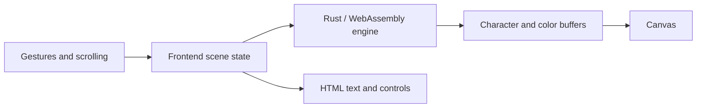

<Tldr title="At a glance">
**The project:** A Rust engine renders a cube using ASCII characters. It is compiled to WebAssembly and used in this portfolio.

**My role:** Building the renderer and its browser integration: face textures, interaction and transitions.

**The main decision:** Keep rendering calculations in Rust and let the frontend handle layout, gestures and navigation.

**What the demo shows:** One cube persists throughout the desktop journey. On mobile it becomes a small introductory experiment, leaving room for reading.
</Tldr>

## From a terminal experiment to a web interface

The original cube ran in a terminal and changed its rotation speed with the Bitcoin price. That experiment made me want to separate the rendering engine from its display environment.

The browser offered new possibilities: showing technologies on the faces, manipulating the volume directly and integrating it into a page. It also introduced constraints around text readability, resizing and touch interaction.

## Splitting responsibilities between Rust and the frontend



Rust calculates projection, visible faces and the characters to display. `wasm-bindgen` exposes the engine methods and access to its buffers. The frontend reads that data to draw the result on a canvas.

Presentation text and buttons remain in HTML. Visitors should be able to understand the projects, download the résumé and navigate without having to read an ASCII face.

This separation also allows one engine instance to persist. Changing chapters updates the existing scene rather than creating a new cube each time.

## Making the ASCII surface readable

Scaling a character block with CSS is not enough for a good close-up. The rendering grid, character proportions and internal canvas resolution all matter.

The portfolio version uses a **240 × 120 cell grid**. The engine adapts face sampling to this grid. The frontend then needs to preserve proportions when drawing and resizing it.

Different face brightness levels help reveal the volume. Logos are converted into ASCII textures rather than overlaid as HTML images. On the introduction, logos cycle on hidden faces to avoid visible replacements during rotation. Changes between topics use a texture transition.

Quality depends on the whole pipeline: texture, projection, sampling and display. Character density alone does not guarantee a sharp result.

## Rotating without accumulating Euler angles

Free interaction quickly reveals the limitations of adding angles around three axes. Certain orientations produce a singularity, usually called *gimbal lock*.

In the current portfolio implementation, **interactive orientation is stored as a quaternion in the frontend**. Pointer movement is projected onto a virtual sphere: two successive pointer positions define a rotation, which is composed with the current orientation.

The Rust engine still receives three angles through `set_rotation`. They are calculated from the quaternion each frame. The important distinction is that these angles are not reused as state to increment on the next gesture.

This orientation handling is separate from the projection performed in Rust. Using WebAssembly does not mean that all interaction logic belongs in the engine.

## Adding inertia that settles

After a drag, the cube retains angular velocity estimated from the gesture. That velocity gradually decreases. The following function is part of the portfolio frontend:

```typescript
export function coast(q: Quaternion, velocity: number[], dt: number) {
  const decay = Math.exp(-5 * dt),
    travel = (1 - decay) / 5
  return {
    rotation: multiply(fromVector(velocity.map(v => v * travel)), q),
    velocity: velocity.map(v => v * decay)
  }
}
```

`dt` is elapsed time. Motion is calculated over time rather than by adding a fixed displacement each frame. The aim is consistent deceleration despite changes in frame rate.

Reduced-motion preferences and the pause control alter this behavior. Inertia should provide interaction feedback without making the cube difficult to stop.

## Adapting the demo to the reading context

On desktop, the cube’s position accompanies the chapters. Scale and orientation changes are concentrated in transitions, with calmer reading phases.

On phones, priorities differ. The page uses native scrolling and gives the cube a small slot after the introductory information. Vertical gestures on the cube scroll the page; horizontal gestures rotate it. Rendering is suspended when that slot leaves the viewport.

This decision matters as much as the engine: a technical demo helps the portfolio only when it leaves the content accessible.

## Checking the result and acknowledging limits

Portfolio checks cover rendering geometry, rotation and inertia, instance persistence and browser journeys across several viewport sizes. Screenshots catch what calculation tests cannot: obscured text, poor contrast or an oversized cube.

These checks are not a performance benchmark across all devices. I do not have measurements here to claim “native speed” or a quantified improvement over another implementation.

Nix pins build inputs through the flake and lockfile. That makes rebuilding with a known toolchain easier; dependency availability and machine capabilities remain constraints.

**Explore the source:** [Rust engine](https://github.com/Strange500/ascii-cube-rs), [orientation and inertia](https://github.com/Strange500/nextPortfolio/blob/main/lib/cube-orientation.ts), [portfolio integration](https://github.com/Strange500/nextPortfolio/blob/main/components/ScrollCubeScene.tsx).
