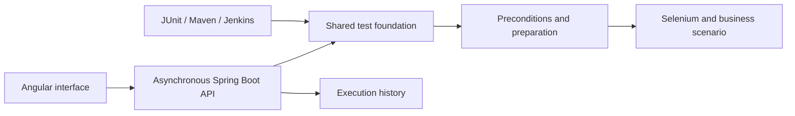
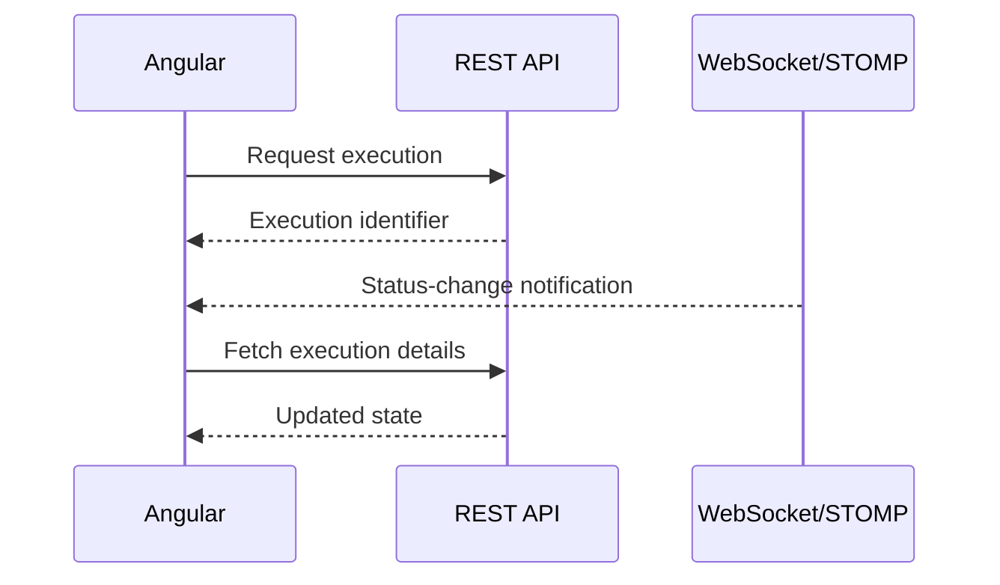

<Tldr title="At a glance">
**Context:** At Numih France, an existing Selenium suite needed to remain usable in Jenkins while becoming available on demand through a web interface.

**My role:** Framework refactoring, migration to Spring Boot and asynchronous API development within a collaborative backend project. I built the Angular interface end to end, starting in August 2026, using Angular, its libraries and a generated REST client.

**Result:** A shared test foundation for CI and users: parameterized launches, history, scheduling and execution monitoring. Across the reported scope of 50–70 tests, adapting to a new environment or major version went from roughly four hours to under ten minutes, according to my work experience.

**Limit:** These are reported estimates, not a benchmark with a published methodology. Employer code is private; the diagrams below explain responsibilities without reproducing that code.
</Tldr>

## The problem: evolving an existing system

I have contributed to this suite since September 2025 as part of my software engineering apprenticeship. The project already had Selenium business scenarios, page abstractions and Jenkins pipelines.

The challenge was both to make browser interactions more reliable and to support uses beyond nightly builds. Users needed to select a scenario, supply parameters and retrieve its outcome without operating Jenkins or duplicating the scenario in a second engine.

## My contribution over time

The refactoring progressed in stages. Other team members also contributed to the backend and business scenarios.

| Period | My contribution |
| --- | --- |
| Since September 2025 | Maintaining scenarios, adapting to environments and working on the data required by tests. |
| January–June 2026 | Reusable Selenium element, table and processing abstractions; pagination, documentation and related unit tests. |
| July 2026 | Spring Boot migration, typed parameters, execution conditions and asynchronous API launches. |
| From August 2026 | Backend result persistence and history; development of the entire Angular interface. |
| September–October 2026 | Test cancellation, endpoint permissions, daily-run integration and simple recovery after restart. |

I do not claim sole authorship of the platform. Business scenarios, scheduling and server-side WebSocket publishing also include work by other team members. My scope includes integrating these capabilities into the Angular interface.

## The central choice: separate a scenario from its trigger

The same scenario should run from CI or a user request. Its parameters and business steps should not depend on the trigger.

This is a responsibility diagram, not an exhaustive class map. The shared foundation handles parameters, preconditions, preparation and cleanup, and result production.

### Reusable Selenium abstractions

Much of the work preceded the API: extracting common operations instead of repeating table reading, processing tracking or element lookup in every scenario.

Table abstractions were made generic and progressively integrated into pages. Unit tests against test HTML pages cover these behaviors. A shared component becomes easier to evolve, but changes still need checking across the scenarios that use it.

### Asynchronous execution for the web

An HTTP request should not remain open throughout a Selenium run. The API validates parameters, creates an execution and submits work to a background executor. The interface can display its states: queued, running, successful, failed, skipped or cancelled.

Typed parameters describe the expected inputs and allow validation before launch. History retains information for understanding a run and retrieving its logs or screenshots.

## The Angular interface: making tests usable

I started the interface in early August 2026 and built it end to end. It includes:

- A scenario catalogue and parameterized launches.
- Active executions, recent results and per-test activity.
- Execution logs and screenshots.
- Test scheduling, activation and deletion.
- Authentication, user preferences and execution cancellation.

The REST client is generated from the OpenAPI description. This lets me focus on user flows and application state while keeping types aligned with the server contract.

### WebSocket notifications and REST details

The interface combines WebSocket/STOMP notifications with REST reads: after a status-change notification, it fetches execution details through REST and updates its lists.

The notification does not carry the full result. The backend remains the source of state. Server-side WebSocket publishing is a team contribution; I implemented its frontend integration.

## Results and strength of evidence

| Item | What I can claim |
| --- | --- |
| 50–70 tests | Reported scope of tests made more reliable; the count depends on the scope and version considered. |
| Roughly 4 h → under 10 min | Reported estimate for adapting tests after an environment change or major application version. This is not the runtime of the entire suite. |
| Roughly 70% fewer false positives | Reported estimate after refactoring. I do not have the measurement context needed to specify the period, denominator or calculation method. |
| Shared API and interface | Capabilities visible in the implementation: launching, history, status notifications, scheduling and cancellation. |

Code and history establish capabilities and the progression of the work. They do not, by themselves, prove a time saving or percentage improvement.

The Spring Boot tool distributing product-support duties across roughly 40 developers is a separate delivery mentioned in my résumé, not part of this test platform.

## Tradeoffs and limitations

**Preconditions and isolation are different problems.** Checking whether a scenario can start avoids some unnecessary executions. It does not guarantee that concurrent tests never mutate the same data. Data preparation, cleanup and isolation remain necessary.

**Restart recovery is simple.** An October 2026 change requeues persisted executions that are still active at startup. This does not guarantee exactly-once execution: an interrupted scenario may already have produced side effects.

**Parallelism must respect the application under test.** A thread pool does not remove business conflicts, browser constraints or the capacity limits of a shared environment.

**Reliability also depends on scenarios.** Better orchestration does not automatically fix a fragile selector or an incorrect wait. Work on reusable abstractions and related tests remains essential.

## What I learned

The challenge was more than adding a REST controller. It involved evolving an existing system, preserving CI usage and making execution state understandable in an interface used by other people.

This work connects my main interests: Java backend development, software quality and tools built for a team.

<Cta title="Let’s discuss your team">
I am seeking a **three-month software engineering internship from June 2027**, in backend development or software tooling. Contact me on [LinkedIn](https://www.linkedin.com/in/roget-benjamin) or by [email](mailto:benjamin.rogetpro@gmail.com).
</Cta>
