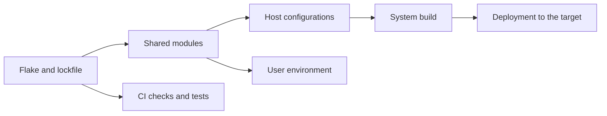

<Tldr title="At a glance">
**The need:** Recover a known environment across several machines and reduce manual settings that get lost over time.

**My role:** Organizing my personal configuration into reusable modules, describing services and routing, and adding CI checks.

**The result:** One flake groups six host configurations and an installer image. Common choices are shared; hardware and roles remain specific to each target.

**The limit:** Rebuilding configuration does not restore data. Persistence, backups, keys and service state need separate management.
</Tldr>

## The problem: recovering the decisions made on a machine

My development environment and personal server accumulated settings for tools, services, networking and the editor. Manual installation works, but eventually it becomes difficult to distinguish useful decisions from forgotten experiments.

I chose NixOS to keep these decisions in a repository and reuse common components. The aim is not to eliminate maintenance, but to make changes visible, reviewable and easier to rebuild.

## Composing machines from modules

The [nixos-config](https://github.com/Strange500/nixos-config) repository separates host configurations, shared modules and the user environment managed by Home Manager.



| Target | Target-specific choices | Shared components |
| --- | --- | --- |
| Personal server | Storage, services and persistence | System foundation and service modules |
| Development workstations | Hardware and desktop session | Editor, tools and user preferences |
| Gaming PC | Gaming configuration | System and desktop modules |
| ARM host | Hardware architecture | Modules compatible with the target |
| Installer image | Boot environment | Modules required for installation |

The ISO is a flake output, not a seventh running machine. This distinction separates the number of declared targets from the number of hosts.

The lockfile pins input revisions. It allows builds using known dependencies and makes updates reviewable before activation. On its own, it does not guarantee that a service will run on any hardware or without access to the required dependencies.

## Describing a service in one place

Routing provides a useful example. Services expose declarations through `qgroget.services`, and the Traefik module combines them to produce its dynamic configuration.

Excerpt from the [Traefik module](https://github.com/Strange500/nixos-config/blob/main/modules/server/traefik/default.nix):

```nix
services = config.qgroget.services;
mergedTraefikConfig =
  lib.foldl'
  lib.recursiveUpdate
  {}
  (map (svc: svc.traefikDynamicConfig) (lib.attrValues services));
```

This keeps a service definition close to its subdomain, TLS settings and associated protections. Changes are easier to review when these details stay connected rather than spread across independent files.

The mechanism does not replace an understanding of networking. Open ports, incorrect routes and permission errors remain possible. Tests should check expected behavior, not just the presence of a Nix option.

## Separating the reset root from persistent data

On the ZFS server, a boot service restores the root filesystem from a reference snapshot. Files and directories that must survive are declared in the persistence configuration.

This reduces manual changes accumulating in the root filesystem. It also requires identifying useful state: databases, service identities and files required at startup.

It does not mean that all machine state is described by Nix. The contents of a persistent directory can evolve independently of configuration. Backups and a restoration procedure remain necessary.

The repository’s storage file also describes an existing installation. It should not be treated as a universal partitioning procedure or applied to another machine without adaptation.

## Keeping secret values out of public configuration

Modules reference secrets; their values are encrypted with SOPS/age and supplied to services through `sops-nix`.

This makes configuration easier to version without directly embedding runtime values. Decryption keys, permissions and machine access still require management. An encrypted file is not a security audit of the whole infrastructure.

## Testing before activating a configuration

The repository workflow includes flake checks, NixOS integration tests and configuration builds, including checks for secret activation and services.

The x86_64 build matrix contains `Server`, `Clovis`, `Cube`, `Septimius`, `Clotaire` and `installer`. The ARM target is outside this matrix: a successful x86_64 build does not automatically validate it.

```sh
# Evaluate and run checks declared by the flake
nix flake check

# Build the server system without activating it
nix build .#nixosConfigurations.Server.config.system.build.toplevel
```

These checks can catch evaluation and compilation errors, along with some behavioral failures in the tested scenarios. They do not establish that every feature is covered or that backups can be restored. Building, activating and restoring are separate operations.

## What I take from this approach

The main benefit is being able to explain and review configuration choices, then share them across targets. Adding a tool or changing a service becomes an identifiable code change.

There is still a cost: learning Nix, interpreting difficult diagnostics and adapting to nixpkgs updates. I prefer investing that effort in reusable modules while keeping explicit the things Nix does not manage for me.

**Explore the source:** [configuration and modules](https://github.com/Strange500/nixos-config), [validation workflow](https://github.com/Strange500/nixos-config/blob/main/.github/workflows/ci.yml).

<Cta title="Get in touch">
I am seeking a **three-month internship from June 2027** in backend development or software tooling. Contact me on [LinkedIn](https://www.linkedin.com/in/roget-benjamin) or by [email](mailto:benjamin.rogetpro@gmail.com).
</Cta>
