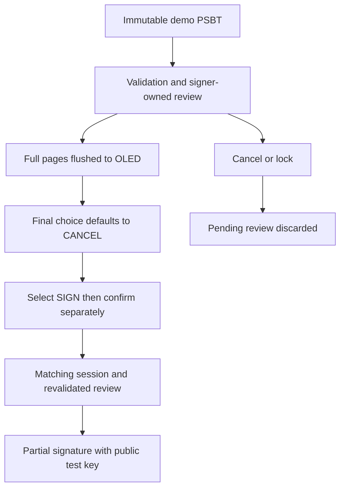

I wanted to build my own “Ledger” to understand how a hardware wallet works. A board, a screen, two buttons, a key that stays inside the device: that was the starting point. But as the project developed, the question shifted. **Being able to produce a signature is not enough. The user needs to know exactly what they are authorizing.**

A valid signature can cover a transaction nobody actually understood. The work therefore cannot stop at cryptography: verified data, its display and a confirmation gesture have to mean the same thing.

<Alert variant="warning">

This “homemade Ledger” is a learning prototype, not affiliated with Ledger and not offering equivalent guarantees. Do not entrust funds to it. This account describes the repository as of **November 10, 2026**; the physical Pico PSBT flow still needs verification. Below, I distinguish merged code from proposals still under review.

</Alert>

<Tldr title="The thread running through the project">

- The prototype moved from RP2040 to **Pico 2 W / RP2350**, with a 128 × 64 OLED and two buttons.
- The portable core is merged; PSBT review and confirmation remain on a development branch.
- The goal: bind **one validated transaction, pages actually displayed and fresh authorization**.

</Tldr>

## Starting with a board, not all the answers

I initially started with Arduino, then encountered limitations that led me in a different direction. That is my recollection of the journey, not a hardware comparison: the repository documents neither the Arduino model, a memory measurement nor a specific incompatibility. I cannot turn that decision into a general verdict on Arduino.

The history verifiable in Git starts with Rust on RP2040. Later, the [migration to RP2350](https://github.com/Strange500/pico-ledger/commit/a40c4cc) changes the compilation target, memory layout and flashing tools, and adds CYW43 support. Today the project targets Pico 2 W. This is more than changing a board name in the same configuration.

<figure>
  
  <figcaption>The setup shared for this article: the screen shows the BIP39 phrase-generation prompt, not a transaction awaiting confirmation. <a href="https://immich.qgroget.com/share/ndMjKLI5DE_a973VinNlAH8ozRyOJNU0nU1GcJMD0GLzuMWQfBdUpr_Yfa9h7PJxzw0">Source photo</a>.</figcaption>
</figure>

## Waiting for a button should not hold everything else up

Library choices become more interesting when tied to a problem. Initially, the button is polled in a loop with a blocking delay. The [move to Embassy](https://github.com/Strange500/pico-ledger/commit/38e2d15) replaces that handling with a task that awaits a GPIO edge, then uses a nonblocking debounce delay. The display reads a counter and refreshes in a separate asynchronous loop.

The observable result in the code is separation between waiting for input and refreshing the display. That commit still uses a blocking I2C driver: adopting Embassy did not make every operation asynchronous at once. The current firmware goes on to separate buttons, display, locking and the signer into tasks, with asynchronous I2C initialization. That progression explains the decision better than a benchmark reconstructed after the fact.

The screen presents another problem: having a string to draw is not enough; states and views need organizing on 128 × 64 pixels. [Introducing Buoyant](https://github.com/Strange500/pico-ledger/commit/cd0014c) changes how the interface is composed. For the next stage, that constraint becomes crucial: a complete address needs multiple pages, not an ellipsis hiding its end.

## Moving logic off the board so it can be questioned

The firmware begins like this in [`src/main.rs`](https://github.com/Strange500/pico-ledger/blob/f60e1ada64816794126a6d0f017cd6b65b513ccf/src/main.rs):

```rust
#![no_std]
#![no_main]

extern crate alloc;
```

No standard library does not mean no allocations: that same file initializes a 128 KiB heap. A successful build therefore does not answer “will this fit while processing a transaction?”.

To examine logic without depending on the board, the [merged portable core](https://github.com/Strange500/pico-ledger/blob/f60e1ada64816794126a6d0f017cd6b65b513ccf/crates/core/src/tests.rs) separates interface states and wallet logic from hardware adapters. Tests can record emitted commands instead of driving GPIOs. For example, when the command queue is full, the password-creation screen stays in place so the user can retry; failing to send a command must not look like an operation has started.

The same file checks rejection of a wrong password, tampered ciphertext and a signing request after locking. Those are specific behaviors I can inspect on a computer, rather than a vague promise of “security through Rust.”

## A PSBT to understand what will be signed

A **PSBT**, or *Partially Signed Bitcoin Transaction*, is a format carrying a Bitcoin transaction and the information signers need, then collecting their partial signatures. [BIP 174](https://bips.dev/174/) describes the format, including its use by an offline signer.

In my project, its role is concrete: replace a request to sign an opaque hash with data the core can validate and turn into a readable review. The [proposed backend](https://github.com/Strange500/pico-ledger/blob/0990c9a24dfa61675f761b6bc5e06092099ac2f8/docs/psbt.md) checks previous transactions, input ownership, derivation paths and outputs, among other things. It calculates totals and the absolute fee in satoshis. An output does not become change simply because the computer labels it that way: that classification must be verified.

When signing, the core revalidates the PSBT and presents that exact review to a trusted in-process approver. This mechanism alone does not prove a person read the screen. The hardware layer still has to make that connection.

## The “yes” that arrives too late

Here is a **hypothetical scenario**, not an incident observed on my setup: someone reads transaction A and presses confirm. The event waits in a queue. Meanwhile, A is cancelled or replaced with B. If the program treats that button as a generic “yes,” which transaction has it just authorized?

That is the kind of threat motivating the [proposed review and confirmation flow](https://github.com/Strange500/pico-ledger/blob/0990c9a24dfa61675f761b6bc5e06092099ac2f8/docs/psbt-demo.md). The signer retains its own review and binds it to a session token; only confirmation for that session can consume it. The demo revalidates the same immutable bytes compiled into the firmware. Cancelling, locking or starting a new request invalidates the previous pending review; wrong-session and already-consumed confirmations cannot sign.

A computed view is not necessarily a visible one, either. In this proposal, review buttons wait until a frame has successfully flushed to the OLED; events carry a display epoch, and those from older frames are rejected. The final choice starts on **CANCEL**. Selecting **SIGN**, then separately confirming with both buttons, are two distinct gestures.



This diagram describes the proposed demo, not an external transaction importer. Its value is making the chain between **what I show** and **what I agree to sign** explicit.

## Where things stand, and what is missing

<table>
  <thead><tr><th>Scope</th><th>Status on November 10, 2026</th></tr></thead>
  <tbody>
    <tr><td>Portable core, states and host tests</td><td>Merged into main</td></tr>
    <tr><td>Strict testnet BIP84 PSBT backend</td><td>PR #18 open, draft</td></tr>
    <tr><td>Opt-in demo, then review and confirmation</td><td>PR #19 open; #20 draft, stacked on #19</td></tr>
    <tr><td>PSBT flow on a physical Pico</td><td>Still to verify</td></tr>
  </tbody>
</table>

The [project’s pull requests](https://github.com/Strange500/pico-ledger/pulls) remain the reference for live status. The PSBT code described here is not yet merged into `main`, which retains the older demonstration signing path using a fixed hash.

The limitations fit into a few points. The new demo uses a **deliberately public test key**, a fixture without spendable funds and a `psbt-demo` feature disabled by default. It does not sign with the user’s wallet, import anything over USB or Wi-Fi, or finalize or broadcast a transaction. The documented host tests validate neither GPIOs, actual TRNG, Embassy scheduling nor peak heap or stack use. The software stale-event guard is not a physical latency measurement. Lock/confirmation ordering, durable storage, erasure of every secret copy, coordinator interoperability and independent audit remain work items; signing already accepted may finish before a subsequently queued lock.

## The next result has to come from the Pico

My next milestone is to follow the [demo’s hardware procedure](https://github.com/Strange500/pico-ledger/blob/0990c9a24dfa61675f761b6bc5e06092099ac2f8/docs/psbt-demo.md) on Pico 2 W: flash explicitly with `psbt-demo`, open USB capture, step through every page and check the fixture’s **1,000-satoshi** fee. Then select SIGN and confirm with both buttons.

The observable criterion will be a complete signed-PSBT capture that the host utility verifies against the **379-byte** signed fixture. Cancellation or locking during review must produce no signed output, holding a button must not repeat the action, and flashing without the feature must leave Home displaying `Signing disabled`. These are expected results, not tests already performed.

That is where I want to take this project: not just to a mathematically correct signature, but to a gesture whose meaning is visible, precise and verifiable.

## Contribute

If you would like to help, the [pico-ledger repository](https://github.com/Strange500/pico-ledger) and PSBT review branch are open: feedback on page readability, stale events or a hardware capture following the procedure would be particularly useful. Include the tested revision and observations, without sharing secrets or using real funds.

<Cta title="Talk about this work">

I am looking for a **3-month software engineering internship in the US, starting June 2027**. To discuss embedded Rust, testing or interfaces, [find me on LinkedIn](https://www.linkedin.com/in/roget-benjamin).

</Cta>
