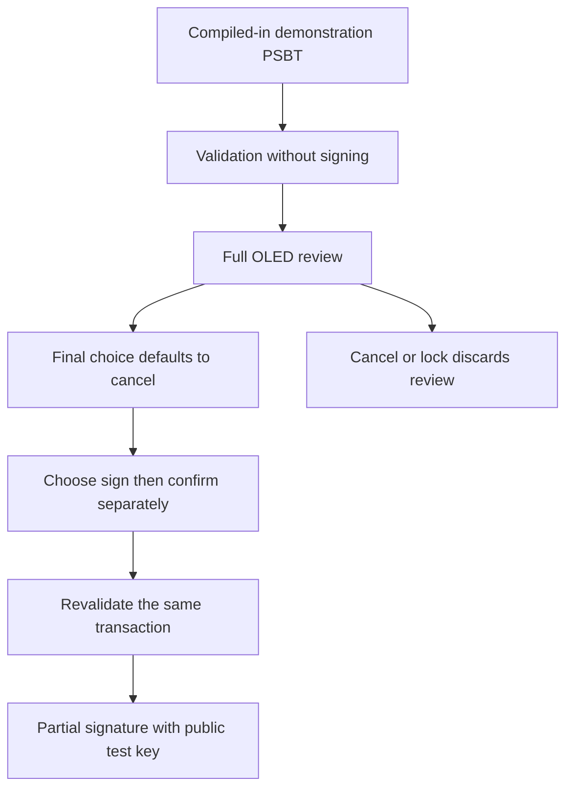

<Tldr title="Where the project stands">

- The firmware now targets the **Raspberry Pi Pico 2 W and its RP2350**; the first commits targeted RP2040.
- The portable core and its host tests are merged into `main`. PSBT work remains in **open PRs**, including a draft hardware-review workflow.
- The PSBT demo uses a public test key and a fabricated transaction: **not a user's funds**.
- The PSBT workflow has not been tested on a physical Pico. This is a learning prototype, not a wallet to trust with funds.

</Tldr>

Building my own “Ledger” is first a way to understand what a hardware wallet actually needs to do. Producing a signature is one thing. Showing exactly what it authorizes, then obtaining explicit consent, is another.

Here, “Ledger” describes the idea of a homemade hardware wallet, not a Ledger product or an equivalent security guarantee. This is the state of [pico-ledger](https://github.com/Strange500/pico-ledger) on **November 10, 2026**, distinguishing merged code from experiments still under review.

## It started as an Arduino idea

Arduino was my initial starting point. Its limitations led me to change direction and move to a Raspberry Pi Pico.

I will not attribute that decision to a particular model, a memory measurement or an Arduino library: those details are not documented in the repository. The beginning of this story is a design intention; the verifiable technical history starts with the Rust RP2040 project.

That distinction matters: I can explain the change in board family without inventing a retrospective benchmark.

## From the first Pico to Pico 2 W

The [first merged Rust project](https://github.com/Strange500/pico-ledger/commit/eb6b019) uses `rp-pico`, `embedded-hal` and `cortex-m-rt`, with a Nix environment. It is a bare-metal foundation: a board, peripherals and a cross-compilation toolchain, not a complete wallet.

SSD1306 display support comes next, followed by button handling. The [move to Embassy](https://github.com/Strange500/pico-ledger/commit/38e2d15) replaces blocking button handling with an asynchronous task and moves I2C communication toward async operation. The framework was not a fixed choice from the first commit: it appears as the interactions multiply.

Another separate step is the [RP2350 migration](https://github.com/Strange500/pico-ledger/commit/a40c4cc). The target changes from `thumbv6m-none-eabi` to `thumbv8m.main-none-eabihf`. Today's code targets **Pico 2 W**, not the original RP2040 Pico. Linker configuration, memory layout, flashing tools and drivers all have to follow; changing the board's name is not enough.

## Libraries chosen along the way

The current stack reflects that progression:

- **Embassy** orchestrates asynchronous tasks and communication between buttons, display, locking and signing.
- **`ssd1306` and `embedded-graphics`** provide the driver and graphics primitives for the 128 × 64 OLED.
- **Buoyant**, [introduced after Embassy](https://github.com/Strange500/pico-ledger/commit/cd0014c), composes the interface views.
- **`bip39` and `bitcoin`** provide mnemonic, key derivation and Bitcoin building blocks.
- **`chacha20poly1305`, `pbkdf2` and `zeroize`** are present in the core for entropy encryption, key derivation and explicit cleanup of some sensitive data.

These are dependencies actually declared in the two `Cargo.toml` files, not a list of libraries I supposedly compared before starting. Their presence proves neither secure persistent storage nor erasure of every secret copy in memory.

The CYW43 coprocessor also plays a role, notably in driving the onboard LED. That **does not mean** a network transaction transport is available. Likewise, USB logs are not yet a PSBT import interface.

## What embedded Rust forces me to examine

The beginning of [`src/main.rs`](https://github.com/Strange500/pico-ledger/blob/f60e1ad/src/main.rs) captures a difference from desktop Rust:

```rust
#![no_std]
#![no_main]

extern crate alloc;
```

There is no standard library or conventional entry point, but dynamic allocation is still possible. The firmware currently initializes a 128 KiB heap through `embedded-alloc`. Allocations, stack usage and actual microcontroller limits matter; successfully compiling a binary is not sufficient.

Async also shifts the difficulty. A button sends an event, a task changes state, the screen renders a view, and the signer processes a command. Confirmation must not apply to an old transaction because an event was waiting in a queue. Computing a view does not prove that the screen actually displayed it.

The [merged PR #16](https://github.com/Strange500/pico-ledger/pull/16) separates a portable `pico-ledger-core` from hardware adapters. This is concrete progress: state transitions, cryptographic failures and locking can be tested on a host without a connected board. Those tests do not validate GPIO, the real TRNG, Embassy timing or peak RAM consumption on the Pico.

## PSBT work: signing is not authorization

A PSBT is a Partially Signed Bitcoin Transaction: a format for preparing a transaction elsewhere and having a signer verify and sign its components. The goal is not to turn the Pico into a machine that blindly signs a hash supplied by a computer.

As of this date, the stages remain separate:

1. **On `main`**, the portable core is merged, but the old hash-signing method is still present. This is not a secure end-to-end PSBT workflow.
2. **[PR #18](https://github.com/Strange500/pico-ledger/pull/18), a draft**, proposes the PSBT v0 backend: transaction validation, structured review and partial signatures. Its deliberately narrow policy covers testnet P2WPKH with verified BIP32 origins and `SIGHASH_ALL`.
3. **[PR #19](https://github.com/Strange500/pico-ledger/pull/19), open**, adds an explicitly enabled `psbt-demo` demonstration using a public test key and a PSBT compiled into the binary.
4. **[PR #20](https://github.com/Strange500/pico-ledger/pull/20), a draft stacked on #19**, adds paginated review and a distinct physical confirmation step. It is not merged into `main`.

This is the **demo workflow proposed by #20**, not an already available production feature:



The important detail is the separation between **preparing**, **displaying** and **authorizing**. The proposal binds a session to an immutable transaction, rejects stale or reused confirmations, and gates navigation on a successfully flushed OLED view. Addresses, amounts and fees must be reviewable without hiding an address suffix behind an ellipsis.

This demo accepts no external PSBT. It does not use the user's normal wallet and does not finalize or broadcast a transaction. A successful partial signature in this setting therefore does not establish that the prototype can already spend bitcoin.

## Limitations I do not want to gloss over

<Alert variant="warning">

**Prototype only: do not put funds on it.** The demo documentation forbids funding its public key. PR #20 explicitly states that no physical Pico, display, buttons or serial device was tested during its implementation.

</Alert>

The host tests and cross-builds reported in that PR are useful, but they do not replace:

- on-board verification of every page and freshness of button presses;
- stack and heap measurements during PSBT parsing and cryptographic operations;
- validation of the TRNG, confirmation-versus-lock races and communication failures;
- a round trip with a real testnet coordinator and an independent security audit.

Even in the demo, already-authorized signing may finish before a queued lock is processed. USB logging remains best effort: success on screen does not guarantee the computer received the complete result. Existing memory protections are not proof of exhaustive secret erasure either.

## Next: verify the boundaries, not just a “signing” checkbox

The next milestone is not adding another “sign” button. It is verifying that the user sees the right transaction, that only fresh consent authorizes it, and that errors leave the system in a safe state. Bounded external PSBT transport and user-wallet signing remain substantial work in their own right.

That is precisely what interests me about this project: it connects a cryptographic library, a state machine and two physical buttons. None of these, taken alone, is sufficient to make a reliable hardware wallet.

### Technical sources

- [Merged pico-ledger history at commit `f60e1ad`](https://github.com/Strange500/pico-ledger/tree/f60e1ad): firmware, manifests and portable core.
- [PSBT policy in the #20 work](https://github.com/Strange500/pico-ledger/blob/0990c9a24dfa61675f761b6bc5e06092099ac2f8/docs/psbt.md): accepted scope, trust boundary and blockers.
- [Demo documentation at the same commit](https://github.com/Strange500/pico-ledger/blob/0990c9a24dfa61675f761b6bc5e06092099ac2f8/docs/psbt-demo.md): proposed hardware procedure and unverified limitations.

<Cta title="Want to talk embedded Rust?">

I am looking for a **3-month software engineering internship in the US, starting June 2027**. If your work involves Rust, embedded systems or software reliability, let's connect on [LinkedIn](https://www.linkedin.com/in/roget-benjamin).

</Cta>
