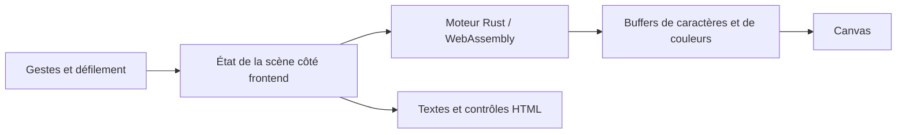

<Tldr title="L’essentiel">
**Le projet :** Un moteur Rust dessine un cube en caractères ASCII. Il est compilé en WebAssembly et utilisé dans ce portfolio.

**Mon rôle :** Développer le moteur et son intégration au navigateur : rendu, textures des faces, interaction et transitions.

**Le choix principal :** Garder le calcul du rendu en Rust, et confier au frontend la mise en page, les gestes et la navigation.

**Ce que montre la démo :** Le même cube reste présent pendant le parcours. Sur mobile, il devient une petite expérience dans l’introduction pour laisser la place à la lecture.
</Tldr>

## D’une expérience dans le terminal à une interface web

À l’origine, le cube tournait dans un terminal et sa vitesse variait avec le cours du Bitcoin. Cette expérience m’a surtout donné envie de séparer le moteur de rendu de son environnement d’affichage.

Le navigateur apportait d’autres possibilités : montrer les technologies sur les faces, manipuler le volume directement et l’intégrer à une page. Il apportait aussi de nouvelles contraintes : lisibilité du texte, redimensionnement et interactions tactiles.

## Répartir les responsabilités entre Rust et le frontend



Rust calcule la projection, les faces visibles et les caractères à afficher. `wasm-bindgen` expose les méthodes du moteur et l’accès à ses buffers. Le frontend lit ces données pour dessiner le résultat dans un canvas.

Les textes de présentation et les boutons restent en HTML. Une personne doit pouvoir comprendre les projets, télécharger le CV et naviguer sans avoir à déchiffrer une face ASCII.

Cette séparation permet aussi de conserver une seule instance du moteur. Changer de section fait évoluer la scène existante ; cela ne crée pas un nouveau cube à chaque fois.

## Rendre la matière ASCII lisible

Agrandir un bloc de caractères avec CSS ne suffit pas à produire un bon gros plan. Il faut tenir compte de la grille de rendu, des proportions du caractère et de la résolution du canvas.

La version intégrée au portfolio utilise une grille de **240 × 120 cellules**. Le moteur adapte l’échantillonnage des faces à cette grille. Le frontend doit ensuite préserver les proportions lors du dessin et du redimensionnement.

Les faces utilisent des luminosités différentes pour que le volume reste identifiable. Les logos sont convertis en textures ASCII ; ils ne sont pas des images HTML simplement superposées au cube. Sur l’accueil, les logos défilent sur les faces masquées pour éviter un remplacement visible pendant la rotation. Les changements de sujet utilisent une transition de texture.

La qualité du rendu dépend donc de toute la chaîne : texture, projection, échantillonnage et affichage. La densité de caractères seule ne garantit pas la netteté.

## Tourner le cube sans accumuler des angles d’Euler

Une interaction libre révèle vite les limites d’une rotation obtenue en additionnant des angles autour de trois axes. Certaines orientations produisent une singularité, généralement appelée blocage de cardan ou *gimbal lock*.

Dans l’implémentation actuelle du portfolio, **l’orientation interactive est conservée sous forme de quaternion côté frontend**. Le geste est projeté sur une sphère virtuelle : deux positions successives du pointeur définissent une rotation, qui est composée avec l’orientation courante.

Le moteur Rust reçoit encore trois angles par sa méthode `set_rotation`. Ils sont calculés à partir du quaternion à chaque image. Le point important est de ne pas réutiliser ces angles comme état à incrémenter au geste suivant.

Il faut distinguer cette gestion de l’orientation de la projection effectuée en Rust. La présence de WebAssembly ne signifie pas que toute la logique d’interaction se trouve dans le moteur.

## Ajouter une inertie qui s’apaise

Après un glissement, le cube conserve une vitesse angulaire estimée à partir du geste. Cette vitesse diminue progressivement. La fonction suivante appartient au frontend du portfolio :

```typescript
export function coast(q: Quaternion, velocity: number[], dt: number) {
  const decay = Math.exp(-5 * dt),
    travel = (1 - decay) / 5
  return {
    rotation: multiply(fromVector(velocity.map(v => v * travel)), q),
    velocity: velocity.map(v => v * decay)
  }
}
```

`dt` représente le temps écoulé. Le mouvement est ainsi calculé en fonction du temps, et non en ajoutant un déplacement fixe à chaque image. L’objectif est une décélération cohérente malgré les variations de cadence.

La réduction des animations et la commande de pause modifient ce comportement. L’inertie doit rester un retour d’interaction, sans rendre le cube difficile à arrêter.

## Adapter la démonstration au contexte de lecture

Sur desktop, les positions du cube accompagnent les chapitres. Les changements de taille et d’orientation sont concentrés dans les transitions ; les phases de lecture restent plus calmes.

Sur téléphone, la priorité est différente. La page utilise le défilement natif et le cube occupe un petit emplacement après les informations de présentation. Un geste vertical sur le cube laisse défiler la page ; un geste horizontal le fait tourner. Son rendu est suspendu quand cet emplacement sort de l’écran.

Ce choix compte autant que le moteur : une démonstration technique n’aide le portfolio que si elle laisse accéder au contenu.

## Vérifier le résultat et reconnaître les limites

Les vérifications du portfolio couvrent notamment la géométrie du rendu, les rotations et l’inertie, la persistance de l’instance et les parcours navigateur sur plusieurs formats. Les captures permettent de repérer ce qu’un test de calcul ne voit pas : un texte masqué, un mauvais contraste ou un cube trop envahissant.

Ces vérifications ne constituent pas un benchmark de performances sur tous les appareils. Je ne dispose pas ici d’une mesure permettant d’annoncer une vitesse « native » ou un gain chiffré face à une autre implémentation.

Nix fige les entrées de compilation dans le flake et son lockfile. Cela facilite la reconstruction avec une chaîne d’outils connue ; la disponibilité des dépendances et les capacités de la machine restent des contraintes.

**Consulter les sources :** [moteur Rust](https://github.com/Strange500/ascii-cube-rs), [orientation et inertie](https://github.com/Strange500/nextPortfolio/blob/main/lib/cube-orientation.ts), [intégration au portfolio](https://github.com/Strange500/nextPortfolio/blob/main/components/ScrollCubeScene.tsx).
