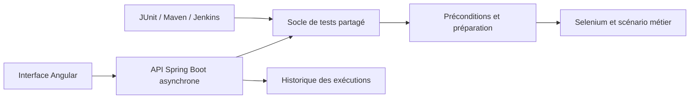
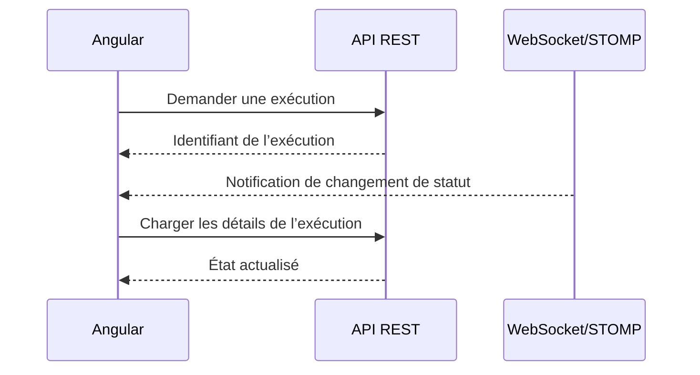

<Tldr title="L’essentiel">
**Contexte :** Chez Numih France, une suite Selenium existante devait rester utilisable dans Jenkins tout en devenant accessible à la demande depuis une interface web.

**Mon rôle :** Refonte du framework et de ses abstractions, migration vers Spring Boot et développement de l’API asynchrone au sein d’un projet backend collectif. Réalisation intégrale de l’interface Angular, commencée en août 2026, en m’appuyant sur Angular, ses bibliothèques et un client REST généré.

**Résultat :** Un même socle de tests pour la CI et les utilisateurs : lancement paramétré, historique, programmation et suivi des exécutions. Sur le périmètre déclaré de 50 à 70 tests, l’adaptation à un nouvel environnement ou une version majeure est passée d’environ quatre heures à moins de dix minutes, selon mon retour d’expérience.

**Limite :** Ces chiffres sont des ordres de grandeur déclarés, pas un benchmark dont le protocole est publié. Le code employeur est privé ; les schémas ci-dessous expliquent les responsabilités sans le reproduire.
</Tldr>

## Le problème : faire évoluer un existant

J’interviens sur cette suite depuis septembre 2025, dans le cadre de mon alternance d’ingénieur logiciel. Le projet ne partait pas de zéro : des scénarios métier Selenium, des pages et des pipelines Jenkins existaient déjà.

L’enjeu était double : fiabiliser les interactions avec l’application et ouvrir les tests à d’autres usages que le build nocturne. Un utilisateur devait pouvoir choisir un scénario, renseigner ses paramètres et retrouver son résultat sans manipuler Jenkins ni dupliquer le scénario dans un second moteur.

## Mon périmètre et sa progression

La refonte s’est construite par étapes, avec des contributions d’autres membres de l’équipe sur le backend et les scénarios métier.

| Période | Ma contribution |
| --- | --- |
| Depuis septembre 2025 | Maintenance de scénarios, adaptation aux environnements et travail sur les données nécessaires aux tests. |
| Janvier à juin 2026 | Abstractions réutilisables pour les éléments, tableaux et traitements Selenium ; pagination, documentation et tests unitaires associés. |
| Juillet 2026 | Migration vers Spring Boot, paramètres typés, conditions d’exécution et lancement asynchrone via l’API. |
| À partir d’août 2026 | Persistance des résultats et historique côté backend ; développement de l’ensemble de l’interface Angular. |
| Septembre à octobre 2026 | Annulation des tests, droits sur les endpoints, intégration des exécutions quotidiennes et reprise simple après redémarrage. |

Je ne revendique pas la totalité de la plateforme : les scénarios, la programmation et la diffusion WebSocket côté serveur comprennent aussi du travail d’équipe. Mon périmètre inclut l’intégration de ces capacités dans l’interface Angular.

## Le choix central : séparer le scénario de son déclencheur

Le même scénario doit pouvoir être lancé par la CI ou par un utilisateur. Ses paramètres et ses étapes métier ne devraient pas dépendre de ce déclencheur.

Ce schéma représente les responsabilités ; ce n’est pas une cartographie exhaustive des classes. Le socle partagé gère notamment les paramètres, les préconditions, la préparation et le nettoyage, ainsi que la production du résultat.

### Des abstractions Selenium réutilisables

Une part importante du travail a précédé l’API : extraire des opérations communes au lieu de répéter dans chaque scénario la lecture d’un tableau, le suivi d’un traitement ou la recherche d’un élément.

Les abstractions de tableaux ont ensuite été rendues génériques et intégrées progressivement aux pages. Des tests unitaires sur des pages HTML de test accompagnent ces comportements. Cette approche facilite l’évolution d’un composant partagé, mais demande de vérifier ses effets sur tous les scénarios qui l’utilisent.

### Une exécution asynchrone pour le web

Une requête HTTP ne doit pas rester ouverte pendant toute l’exécution Selenium. L’API valide les paramètres, crée une exécution et confie le travail à un exécuteur en arrière-plan. L’interface peut ensuite afficher ses états : en attente, en cours, réussie, échouée, ignorée ou annulée.

Les paramètres typés permettent de décrire les entrées attendues et de les valider avant le lancement. L’historique conserve les informations utiles pour comprendre une exécution et retrouver ses logs ou ses captures.

## L’interface Angular : rendre les tests utilisables

J’ai commencé l’interface début août 2026 et l’ai réalisée intégralement. Elle regroupe :

- Un catalogue de scénarios et leur lancement avec des paramètres.
- Les exécutions actives, les résultats récents et l’activité d’un test.
- Les logs et les captures associés à une exécution.
- La programmation des tests, son activation ou sa suppression.
- L’authentification, les préférences utilisateur et l’annulation d’une exécution.

Le client REST est généré depuis la description OpenAPI. Je me concentre ainsi sur les parcours et les états de l’application, tout en gardant des types cohérents avec le contrat serveur.

### Notifications WebSocket et détails par REST

Le suivi de l’interface associe des notifications WebSocket/STOMP et une lecture REST : à la réception d’un changement de statut, elle recharge les détails de l’exécution par REST et met à jour ses listes.

La notification n’embarque donc pas tout le résultat. Le backend reste la source de l’état. La diffusion WebSocket côté serveur est une contribution de l’équipe ; j’ai réalisé son intégration au frontend.

## Résultats et niveau de preuve

| Élément | Ce que je peux en dire |
| --- | --- |
| 50 à 70 tests | Périmètre déclaré des tests fiabilisés ; le nombre dépend du périmètre et de la version considérés. |
| Environ 4 h → moins de 10 min | Ordre de grandeur déclaré pour l’adaptation des tests après un changement d’environnement ou une version majeure. Ce n’est pas la durée de toute la suite. |
| API et interface partagées | Capacités observables dans l’implémentation : lancement, historique, notifications de statut, programmation et annulation. |

Le code et l’historique permettent d’établir les fonctionnalités et la progression du travail. Ils ne suffisent pas à prouver un gain de temps ou un pourcentage d’amélioration.

L’outil Spring Boot qui répartit le support produit entre environ 40 développeurs est une réalisation distincte, mentionnée dans mon CV. Il ne faut pas le confondre avec cette plateforme de tests.

## Les compromis et les limites

**Préconditions et isolation sont deux problèmes différents.** Vérifier qu’un scénario peut démarrer évite certaines exécutions inutiles. Cela ne garantit pas que deux tests simultanés n’altèrent jamais les mêmes données. La préparation, le nettoyage et l’isolation des jeux de données restent nécessaires.

**La reprise après redémarrage est simple.** Une évolution d’octobre 2026 permet de remettre en file les exécutions persistées encore actives au démarrage. Ce mécanisme n’est pas une garantie d’exécution exactement une fois : il faut tenir compte d’éventuels effets déjà produits par un scénario interrompu.

**Le parallélisme doit respecter l’application testée.** Un pool de threads ne supprime ni les conflits métier, ni les contraintes des navigateurs, ni la capacité de l’environnement partagé.

**La fiabilité dépend aussi des scénarios.** Une meilleure orchestration ne corrige pas automatiquement un sélecteur fragile ou une attente mal définie. C’est pourquoi le travail sur les abstractions et les tests associés reste essentiel.

## Ce que cette expérience m’a appris

La difficulté n’était pas simplement d’ajouter un contrôleur REST. Il fallait faire évoluer un existant, conserver son usage en CI et rendre son état compréhensible par une interface destinée à d’autres utilisateurs.

Cette expérience relie mes sujets principaux : backend Java, qualité logicielle et conception d’outils utilisables par une équipe.

<Cta title="Échangeons sur votre équipe">
Je recherche un **stage d’ingénieur logiciel de trois mois à partir de juin 2027**, en backend ou en outillage logiciel. Vous pouvez me contacter sur [LinkedIn](https://www.linkedin.com/in/roget-benjamin) ou par [email](mailto:benjamin.rogetpro@gmail.com).
</Cta>
