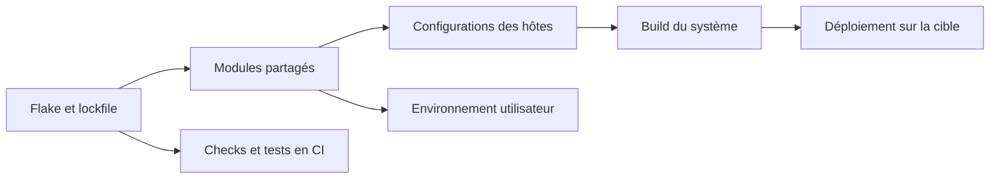

<Tldr title="L’essentiel">
**Le besoin :** Retrouver un environnement connu sur plusieurs machines et limiter les réglages manuels qui se perdent avec le temps.

**Mon rôle :** Organiser ma configuration personnelle en modules réutilisables, décrire les services et leur routage, et mettre en place des vérifications dans la CI.

**Le résultat :** Un flake regroupe six configurations d’hôtes et une image d’installation. Les choix communs sont partagés ; le matériel et les rôles restent propres à chaque cible.

**La limite :** Reconstruire la configuration ne restaure pas les données. Persistance, sauvegardes, clés et état des services doivent être gérés séparément.
</Tldr>

## Le problème : retrouver les choix faits sur une machine

Mon environnement de travail et mon serveur personnel accumulaient des réglages : outils de développement, services, réseau et configuration de l’éditeur. Une installation manuelle fonctionne, mais il devient difficile de distinguer les décisions encore utiles des essais oubliés.

J’ai choisi NixOS pour conserver ces décisions dans un dépôt et réutiliser les éléments communs. L’objectif n’est pas de supprimer toute maintenance : c’est de rendre les changements visibles, révisables et plus faciles à reconstruire.

## Composer les machines à partir de modules

Le dépôt [nixos-config](https://github.com/Strange500/nixos-config) sépare les configurations d’hôtes, les modules partagés et l’environnement utilisateur géré avec Home Manager.



| Cible | Ce qui lui est propre | Ce qui peut être partagé |
| --- | --- | --- |
| Serveur personnel | Stockage, services et persistance | Socle système et modules de services |
| Postes de développement | Matériel et session de bureau | Éditeur, outils et préférences utilisateur |
| PC de jeu | Configuration dédiée au jeu | Socle et modules du bureau |
| Hôte ARM | Architecture matérielle | Modules compatibles avec la cible |
| Image d’installation | Environnement de démarrage | Modules nécessaires à l’installation |

L’image ISO est une sortie du flake, pas une septième machine en fonctionnement. Cette distinction évite de confondre le nombre de cibles déclarées avec celui des hôtes.

Le lockfile fixe les révisions des entrées. Il permet de construire à partir de dépendances connues et de relire une mise à jour avant de l’appliquer. Il ne garantit pas, à lui seul, qu’un service fonctionnera sur tout matériel ou sans accès aux dépendances nécessaires.

## Décrire un service une seule fois

Un exemple utile concerne le routage. Les services exposent leurs déclarations via `qgroget.services`. Le module Traefik combine ces déclarations pour produire sa configuration dynamique.

Extrait du [module Traefik](https://github.com/Strange500/nixos-config/blob/main/modules/server/traefik/default.nix) :

```nix
services = config.qgroget.services;
mergedTraefikConfig =
  lib.foldl'
  lib.recursiveUpdate
  {}
  (map (svc: svc.traefikDynamicConfig) (lib.attrValues services));
```

Cela permet de rapprocher la définition d’un service de son sous-domaine, de son TLS et des protections associées. Une modification est plus facile à relire quand ces informations restent liées, plutôt que réparties dans plusieurs fichiers indépendants.

Ce mécanisme ne remplace pas la compréhension du réseau : un port ouvert, un mauvais routage ou des permissions incorrectes restent des erreurs possibles. Les tests doivent porter sur le comportement attendu, pas seulement sur la présence d’une option Nix.

## Séparer la racine réinitialisée des données persistantes

Sur le serveur ZFS, un service de démarrage restaure la racine depuis un instantané de référence. Les répertoires et fichiers qui doivent survivre sont déclarés dans la configuration de persistance.

Cette séparation réduit les modifications manuelles qui s’accumulent dans la racine. Elle oblige aussi à identifier les états utiles : bases de données, identités des services et fichiers nécessaires au démarrage.

Elle ne signifie pas que tout l’état de la machine est décrit par Nix. Le contenu d’un répertoire persistant peut évoluer indépendamment de la configuration. Une sauvegarde et une procédure de restauration restent nécessaires.

Le fichier de stockage du dépôt décrit aussi une installation existante. Il ne faut pas le présenter comme une procédure universelle de partitionnement ou l’appliquer à une autre machine sans l’adapter.

## Gérer les secrets en dehors des valeurs publiques

Les références aux secrets figurent dans les modules ; leurs valeurs sont chiffrées avec SOPS/age et fournies aux services par `sops-nix`.

Cela facilite le versionnement de la configuration sans y intégrer directement les valeurs utilisées à l’exécution. Il faut toujours gérer les clés de déchiffrement, les permissions et les accès aux machines. Le chiffrement d’un fichier ne constitue pas un audit de sécurité de toute l’infrastructure.

## Tester avant d’activer une configuration

Le workflow du dépôt prévoit des vérifications du flake, des tests d’intégration NixOS et des builds de configurations. Il inclut notamment des checks d’activation des secrets et des services.

La matrice de build x86_64 comprend `Server`, `Clovis`, `Cube`, `Septimius`, `Clotaire` et `installer`. La cible ARM n’appartient pas à cette matrice : un build réussi sur x86_64 ne valide pas automatiquement son fonctionnement.

```sh
# Évaluer et exécuter les checks déclarés dans le flake
nix flake check

# Construire le système du serveur sans l’activer
nix build .#nixosConfigurations.Server.config.system.build.toplevel
```

Ces vérifications permettent de détecter des erreurs d’évaluation, de compilation et certains défauts de comportement dans les scénarios testés. Elles ne démontrent ni que toutes les fonctions ont été testées, ni que les sauvegardes sont restaurables. Construire, activer et restaurer sont trois opérations distinctes.

## Ce que je garde de cette approche

Le principal bénéfice est de pouvoir expliquer et relire les choix de configuration, puis les partager entre plusieurs cibles. Un nouvel outil ou un changement de service devient une modification de code identifiable.

Le coût reste réel : apprentissage de Nix, diagnostics parfois difficiles et adaptation aux évolutions de nixpkgs. Je préfère consacrer cet effort à des modules réutilisables, tout en gardant explicites les éléments que Nix ne gère pas à ma place.

**Consulter les sources :** [configuration et modules](https://github.com/Strange500/nixos-config), [workflow de validation](https://github.com/Strange500/nixos-config/blob/main/.github/workflows/ci.yml).

<Cta title="Échangeons">
Je recherche un **stage de trois mois à partir de juin 2027** en backend ou en outillage logiciel. Vous pouvez me contacter sur [LinkedIn](https://www.linkedin.com/in/roget-benjamin) ou par [email](mailto:benjamin.rogetpro@gmail.com).
</Cta>
