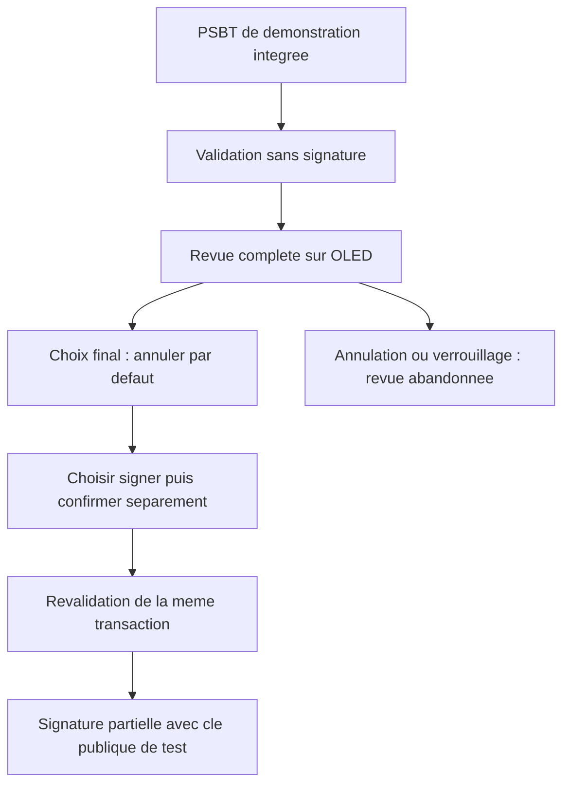

<Tldr title="Où en est le projet ?">

- Le firmware cible aujourd’hui le **Raspberry Pi Pico 2 W, avec un RP2350** ; les premiers commits visaient le RP2040.
- Le cœur portable et ses tests sur ordinateur sont intégrés à `main`. Le travail PSBT reste dans des **PR ouvertes**, dont la revue matérielle en brouillon.
- La démonstration PSBT utilise une clé publique de test et une transaction factice : **pas les fonds d’un utilisateur**.
- Le parcours PSBT n’a pas été testé sur un Pico physique. Ce projet reste un prototype d’apprentissage, pas un portefeuille auquel confier des fonds.

</Tldr>

Fabriquer mon propre « Ledger » est d’abord une manière de comprendre ce qu’un portefeuille matériel doit réellement faire. Produire une signature est une chose. Montrer exactement ce que cette signature autorise, puis recueillir un consentement explicite, en est une autre.

Le mot « Ledger » décrit ici l’idée d’un portefeuille matériel maison, pas un produit Ledger ni une garantie équivalente. Voici l’état du [dépôt pico-ledger](https://github.com/Strange500/pico-ledger) au **10 novembre 2026**, en distinguant le code intégré des expérimentations encore en revue.

## Au départ : une idée Arduino

Mon premier point de départ était Arduino. Ses limitations m’ont conduit à changer de direction et à partir sur un Raspberry Pi Pico.

Je ne vais pas attribuer cette décision à un modèle précis, à une mesure de mémoire ou à une bibliothèque Arduino : je n’ai pas ces éléments documentés dans le dépôt. Le début de l’histoire est une intention de conception ; l’historique technique vérifiable commence avec le projet Rust pour RP2040.

La distinction compte : je peux raconter pourquoi j’ai changé de famille de carte sans inventer un benchmark rétrospectif.

## Du premier Pico au Pico 2 W

Le [premier projet Rust intégré](https://github.com/Strange500/pico-ledger/commit/eb6b019) utilise `rp-pico`, `embedded-hal` et `cortex-m-rt`, avec un environnement Nix. C’est un socle bare-metal : une carte, des périphériques et une chaîne de compilation croisée, pas encore un portefeuille complet.

L’écran SSD1306 arrive ensuite, puis la gestion des boutons. Le [passage à Embassy](https://github.com/Strange500/pico-ledger/commit/38e2d15) remplace la gestion bloquante du bouton par une tâche asynchrone et fait évoluer la communication I2C vers l’asynchrone. Le framework n’était donc pas un choix figé dès le premier commit : il apparaît à mesure que les interactions se multiplient.

Autre étape distincte : la [migration vers le RP2350](https://github.com/Strange500/pico-ledger/commit/a40c4cc). La cible passe de `thumbv6m-none-eabi` à `thumbv8m.main-none-eabihf`. Le code actuel vise le **Pico 2 W**, et non le Pico RP2040 des débuts. Configuration du linker, disposition mémoire, outils de flash et pilotes doivent suivre ce changement ; remplacer simplement le nom de la carte ne suffit pas.

## Les bibliothèques se choisissent en construisant

La pile actuelle raconte cette progression :

- **Embassy** orchestre les tâches asynchrones et les échanges entre boutons, affichage, verrouillage et signature.
- **`ssd1306` et `embedded-graphics`** fournissent le pilote et les primitives graphiques de l’écran OLED 128 × 64.
- **Buoyant**, [introduit après Embassy](https://github.com/Strange500/pico-ledger/commit/cd0014c), sert à composer les vues de l’interface.
- **`bip39` et `bitcoin`** apportent les briques de phrase mnémonique, de dérivation de clés et de manipulation Bitcoin.
- **`chacha20poly1305`, `pbkdf2` et `zeroize`** sont présents dans le cœur pour le chiffrement de l’entropie, la dérivation de clé et l’effacement explicite de certaines données sensibles.

Ce sont les dépendances réellement déclarées dans les deux `Cargo.toml`, pas une liste de bibliothèques que j’aurais toutes comparées avant de démarrer. Leur présence ne prouve ni un stockage durable sécurisé ni l’effacement de toutes les copies de secrets en mémoire.

Le coprocesseur CYW43 intervient aussi, notamment pour la LED embarquée. Cela **ne signifie pas** qu’un protocole réseau de transport des transactions est disponible. De même, les logs USB ne sont pas encore une interface d’import PSBT.

## Ce que Rust embarqué oblige à regarder

Le début de [`src/main.rs`](https://github.com/Strange500/pico-ledger/blob/f60e1ad/src/main.rs) résume une différence avec un programme Rust sur ordinateur :

```rust
#![no_std]
#![no_main]

extern crate alloc;
```

Pas de bibliothèque standard ni de point d’entrée classique ; cela n’empêche pourtant pas l’allocation dynamique. Le firmware initialise actuellement un tas de 128 Kio avec `embedded-alloc`. Il faut donc raisonner sur les allocations, la pile et les limites réelles du microcontrôleur, pas simplement obtenir un binaire compilé.

L’asynchrone déplace aussi la difficulté. Le bouton envoie un événement, une tâche modifie l’état, l’écran rend une vue, puis le signer traite une commande. Une confirmation ne doit pas s’appliquer à une ancienne transaction parce qu’un événement attendait dans une file. Et avoir calculé une vue ne prouve pas que l’écran l’a effectivement affichée.

La [PR #16, intégrée](https://github.com/Strange500/pico-ledger/pull/16), sépare un cœur portable `pico-ledger-core` des adaptateurs matériels. C’est un progrès concret : tester les états, les erreurs cryptographiques et le verrouillage sur ordinateur, sans dépendre d’une carte branchée. Mais ces tests ne valident pas les GPIO, le TRNG réel, les timings d’Embassy ou la consommation maximale de RAM sur le Pico.

## Le chantier PSBT : ne pas confondre signature et autorisation

Une PSBT est une transaction Bitcoin partiellement signée : un format permettant de préparer la transaction ailleurs puis d’en faire vérifier et signer les éléments par un signataire. Le but n’est pas de transformer le Pico en machine qui signe aveuglément un hash fourni par l’ordinateur.

À cette date, les étapes sont séparées :

1. **Sur `main`**, le cœur portable est intégré, mais l’ancienne méthode de signature d’un hash est encore présente. Ce n’est pas un parcours PSBT sécurisé de bout en bout.
2. La **[PR #18](https://github.com/Strange500/pico-ledger/pull/18), en brouillon**, propose le backend PSBT v0 : validation de la transaction, revue structurée et signatures partielles. Sa politique est volontairement limitée à du P2WPKH testnet avec des origines BIP32 vérifiées et `SIGHASH_ALL`.
3. La **[PR #19](https://github.com/Strange500/pico-ledger/pull/19), ouverte**, ajoute une démonstration activable explicitement avec `psbt-demo`, sur une clé de test publique et une PSBT intégrée au binaire.
4. La **[PR #20](https://github.com/Strange500/pico-ledger/pull/20), en brouillon et empilée sur #19**, ajoute la revue paginée et une confirmation physique distincte. Elle n’est pas intégrée à `main`.

Voici le parcours **proposé par #20 pour la démo**, pas une fonctionnalité de production déjà disponible :



Le détail important est la séparation entre **préparer**, **afficher** et **autoriser**. La proposition lie une session à une transaction immuable, refuse les confirmations périmées ou réutilisées et conditionne la navigation à une transmission réussie de la vue vers l’OLED. Adresses, montants et frais doivent être consultables sans masquer une fin d’adresse derrière des points de suspension.

Cette démo ne reçoit pas de PSBT externe. Elle n’utilise pas le portefeuille normal de l’utilisateur et ne finalise ni ne diffuse une transaction. Une signature partielle réussie dans ce cadre n’est donc pas la preuve qu’on peut déjà dépenser des bitcoins depuis ce prototype.

## Les limites que je ne veux pas escamoter

<Alert variant="warning">

**Prototype uniquement : ne pas y déposer de fonds.** La documentation de la démo interdit de financer sa clé publique. La PR #20 indique explicitement qu’aucun Pico, écran, bouton ou périphérique série physique n’a été testé pendant son implémentation.

</Alert>

Les tests sur ordinateur et les compilations croisées rapportés dans cette PR sont utiles, mais ne remplacent pas :

- une vérification sur carte de chaque page et de la fraîcheur des appuis ;
- des mesures de pile et de tas pendant l’analyse PSBT et les opérations cryptographiques ;
- une validation du TRNG, des courses entre confirmation et verrouillage et des erreurs de communication ;
- un aller-retour avec un véritable coordinateur testnet et un audit de sécurité indépendant.

Même dans la démo, une signature déjà autorisée peut finir avant qu’un verrouillage en attente soit traité. Les logs USB restent « best effort » : voir un succès à l’écran ne garantit pas que l’ordinateur a reçu le résultat complet. Et les protections mémoire existantes ne constituent pas une preuve d’effacement exhaustif des secrets.

## La suite : vérifier les frontières, pas cocher « signature »

Le prochain jalon n’est pas d’ajouter un bouton « signer » de plus. C’est de vérifier que l’utilisateur voit la bonne transaction, que seul son accord frais l’autorise et qu’une erreur laisse le système dans un état sûr. Le transport borné de PSBT externes et la signature du portefeuille utilisateur restent des travaux à part entière.

Ce projet m’intéresse précisément pour cela : il oblige à relier une bibliothèque cryptographique, une machine à états et deux boutons physiques. Aucun de ces éléments, pris isolément, ne suffit à fabriquer un portefeuille matériel fiable.

### Sources techniques

- [Historique intégré de pico-ledger, arrêté au commit `f60e1ad`](https://github.com/Strange500/pico-ledger/tree/f60e1ad) : firmware, manifests et cœur portable.
- [Politique PSBT du chantier #20](https://github.com/Strange500/pico-ledger/blob/0990c9a24dfa61675f761b6bc5e06092099ac2f8/docs/psbt.md) : périmètre accepté, frontière de confiance et blocages.
- [Documentation de la démo au même commit](https://github.com/Strange500/pico-ledger/blob/0990c9a24dfa61675f761b6bc5e06092099ac2f8/docs/psbt-demo.md) : procédure matérielle proposée et limites non vérifiées.

<Cta title="Échanger autour de Rust embarqué ?">

Je recherche un **stage d’ingénieur logiciel de 3 mois, à partir de juin 2027**. Si vos sujets touchent au Rust, aux systèmes embarqués ou à la fiabilité logicielle, discutons-en sur [LinkedIn](https://www.linkedin.com/in/roget-benjamin).

</Cta>
