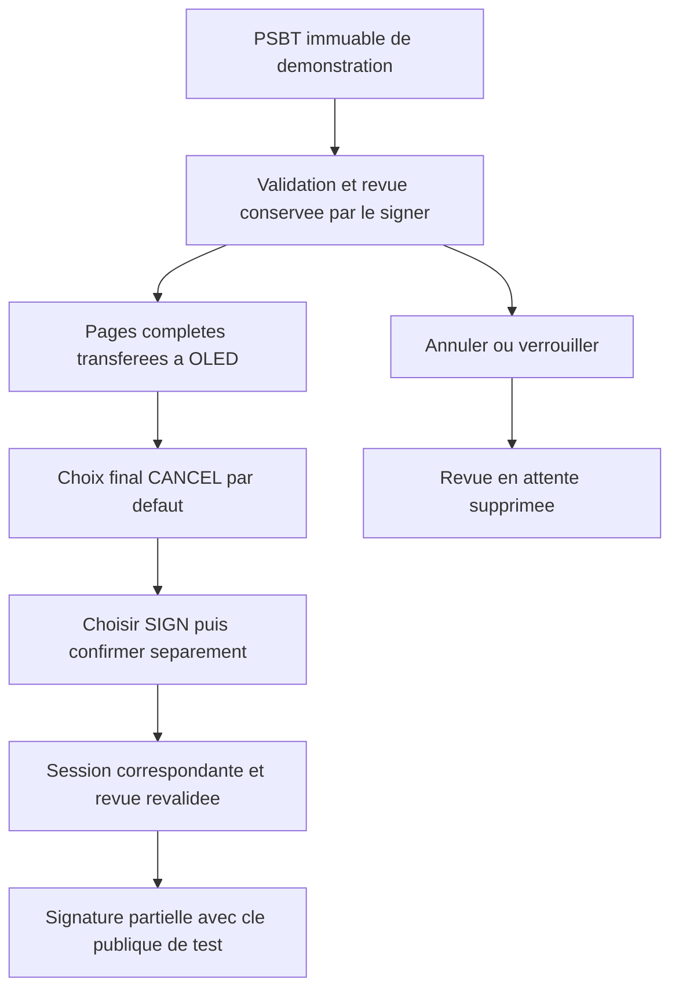

Je voulais fabriquer mon propre « Ledger » pour comprendre comment fonctionne un portefeuille matériel. Une carte, un écran, deux boutons, une clé qui reste dans l’appareil : voilà le point de départ. Mais au fil du projet, la question s’est déplacée. **Savoir produire une signature ne suffit pas. L’utilisateur doit savoir exactement ce qu’il autorise.**

Une signature valide peut porter sur une transaction que personne n’a réellement comprise. Le travail ne s’arrête donc pas au calcul cryptographique : il faut relier les données vérifiées, leur affichage et un geste de confirmation sans laisser de place à une autre interprétation.

<Alert variant="warning">

Ce « Ledger maison » est un prototype d’apprentissage, sans affiliation avec Ledger et sans garantie équivalente. Ne lui confiez pas de fonds. Ce récit décrit le dépôt au **10 novembre 2026** ; le parcours PSBT sur Pico physique reste à vérifier. Je distingue ci-dessous le code intégré des propositions encore en revue.

</Alert>

<Tldr title="Le fil conducteur">

- Le prototype est passé du RP2040 au **Pico 2 W / RP2350**, avec un écran OLED 128 × 64 et deux boutons.
- Le cœur portable est intégré ; la revue et la confirmation PSBT restent dans une branche de travail.
- L’objectif : faire correspondre **une transaction vérifiée, des pages réellement affichées et une autorisation fraîche**.

</Tldr>

## Commencer avec une carte, pas avec toutes les réponses

J’étais initialement parti sur Arduino, puis j’ai rencontré des limitations qui m’ont conduit à changer de direction. C’est le souvenir de mon parcours, pas un comparatif matériel : ni le modèle Arduino, ni une mesure de mémoire, ni une incompatibilité précise ne sont documentés dans le dépôt. Je ne peux donc pas transformer cette décision en verdict général sur Arduino.

L’histoire vérifiable dans Git commence avec Rust sur RP2040. Plus tard, la [migration vers le RP2350](https://github.com/Strange500/pico-ledger/commit/a40c4cc) change la cible de compilation, la disposition mémoire et les outils de flash, et ajoute le support CYW43. Le projet vise aujourd’hui le Pico 2 W. Ce n’est pas seulement un nouveau nom sur la même configuration.

<figure>
  
  <figcaption>Le montage partagé pour cet article : l’écran affiche l’invitation à générer une phrase BIP39, pas une transaction à confirmer. <a href="https://immich.qgroget.com/share/ndMjKLI5DE_a973VinNlAH8ozRyOJNU0nU1GcJMD0GLzuMWQfBdUpr_Yfa9h7PJxzw0">Photo source</a>.</figcaption>
</figure>

## Un bouton qui attend ne doit pas immobiliser le reste

Les choix de bibliothèques deviennent plus intéressants quand on regarde le problème qu’ils résolvent. Au début, le bouton est interrogé dans une boucle avec un délai bloquant. Le [passage à Embassy](https://github.com/Strange500/pico-ledger/commit/38e2d15) remplace cette gestion par une tâche qui attend un front GPIO avec `await`, puis temporise l’anti-rebond sans attente bloquante. L’affichage lit un compteur et se rafraîchit dans une autre boucle asynchrone.

Le résultat observable dans le code est une séparation entre l’attente du bouton et le rafraîchissement. Ce commit utilise encore un pilote I2C bloquant : adopter Embassy n’a pas rendu toutes les opérations asynchrones d’un coup. Le firmware actuel sépare ensuite boutons, affichage, verrouillage et signer en tâches, avec une initialisation I2C asynchrone. C’est cette progression qui explique le choix, pas un benchmark reconstruit après coup.

L’écran pose un autre problème : il ne suffit pas d’avoir une chaîne à dessiner, il faut organiser des états et des vues sur 128 × 64 pixels. [L’introduction de Buoyant](https://github.com/Strange500/pico-ledger/commit/cd0014c) fait évoluer la composition de l’interface. Pour la suite, cette contrainte devient décisive : une adresse complète doit tenir sur plusieurs pages, pas disparaître derrière des points de suspension.

## Sortir la logique de la carte pour pouvoir la questionner

Le firmware commence ainsi, dans [`src/main.rs`](https://github.com/Strange500/pico-ledger/blob/f60e1ada64816794126a6d0f017cd6b65b513ccf/src/main.rs) :

```rust
#![no_std]
#![no_main]

extern crate alloc;
```

Sans bibliothèque standard ne veut pas dire sans allocations : ce même fichier initialise un tas de 128 Kio. Une compilation réussie ne répond donc pas à la question « est-ce que cela tient pendant le traitement d’une transaction ? ».

Pour examiner la logique sans dépendre de la carte, le [cœur portable intégré](https://github.com/Strange500/pico-ledger/blob/f60e1ada64816794126a6d0f017cd6b65b513ccf/crates/core/src/tests.rs) sépare les états de l’interface et le portefeuille des adaptateurs matériels. Les tests peuvent enregistrer les commandes émises plutôt que piloter des GPIO. Par exemple, si la file de commandes est pleine, l’écran de création du mot de passe reste en place pour permettre une nouvelle tentative ; un échec d’envoi ne doit pas être présenté comme une opération lancée.

Le même fichier vérifie le rejet d’un mauvais mot de passe, d’un chiffrement altéré et d’une signature demandée après verrouillage. Ce sont des comportements précis que je peux inspecter sur ordinateur, plutôt qu’une promesse vague de « sécurité grâce à Rust ».

## Une PSBT pour comprendre ce qui va être signé

Une **PSBT**, pour *Partially Signed Bitcoin Transaction*, est un format qui transporte une transaction Bitcoin et les informations nécessaires aux signataires, puis recueille leurs signatures partielles. Le [BIP 174](https://bips.dev/174/) décrit ce format, notamment pour un signataire hors ligne.

Dans mon projet, son rôle est très concret : remplacer une demande de signature sur un hash opaque par des données que le cœur peut contrôler et convertir en revue lisible. Le [backend proposé](https://github.com/Strange500/pico-ledger/blob/0990c9a24dfa61675f761b6bc5e06092099ac2f8/docs/psbt.md) vérifie notamment les transactions précédentes, l’appartenance des entrées, les chemins de dérivation et les sorties. Il calcule les totaux et les frais absolus en satoshis. Une sortie ne devient pas de la monnaie rendue simplement parce que l’ordinateur la présente ainsi : cette classification doit être vérifiée.

Le cœur revalide la PSBT au moment de signer et soumet la revue exacte à un approbateur de confiance dans le programme. Ce mécanisme ne prouve pas, à lui seul, qu’une personne a lu l’écran. La couche matérielle doit encore faire le lien.

## Le « oui » qui arrive trop tard

Voici un scénario **hypothétique**, pas un incident observé sur mon montage : une personne lit la transaction A et appuie sur confirmer. L’événement attend dans une file. Entre-temps, A est annulée ou remplacée par B. Si le programme traite ce bouton comme un simple « oui », à quelle transaction vient-il de donner son accord ?

C’est le type de menace qui motive le parcours de [revue et confirmation proposé](https://github.com/Strange500/pico-ledger/blob/0990c9a24dfa61675f761b6bc5e06092099ac2f8/docs/psbt-demo.md). Le signer conserve sa propre revue et l’associe à un jeton de session ; seule une confirmation de cette session peut la consommer. La démonstration revalide les mêmes octets immuables, compilés dans le firmware. Annuler, verrouiller ou commencer une nouvelle demande invalide l’attente précédente ; les confirmations d’une autre session ou déjà consommées ne peuvent pas signer.

Il faut aussi distinguer une vue calculée d’une vue visible. Dans cette proposition, les boutons de revue attendent qu’une trame ait été transférée avec succès à l’OLED ; les événements portent une époque d’affichage et ceux d’anciennes trames sont rejetés. Le choix final commence sur **CANCEL**. Choisir **SIGN**, puis confirmer séparément avec les deux boutons, sont deux gestes distincts.



Ce schéma décrit la démonstration proposée, pas un import de transactions externes. Son intérêt est de rendre explicite la chaîne entre **ce que je montre** et **ce que j’accepte de signer**.

## Où j’en suis, et ce qui manque

<table>
  <thead><tr><th>Périmètre</th><th>État au 10 novembre 2026</th></tr></thead>
  <tbody>
    <tr><td>Cœur portable, états et tests hôte</td><td>Intégrés à main</td></tr>
    <tr><td>Backend PSBT strict testnet BIP84</td><td>PR #18 ouverte, en brouillon</td></tr>
    <tr><td>Démo opt-in puis revue et confirmation</td><td>PR #19 ouverte ; #20 en brouillon, empilée sur #19</td></tr>
    <tr><td>Parcours PSBT sur Pico physique</td><td>À vérifier</td></tr>
  </tbody>
</table>

Les [PR du projet](https://github.com/Strange500/pico-ledger/pulls) restent la référence pour leur état vivant. Le code PSBT décrit ici n’est pas encore intégré à `main`, qui conserve l’ancien chemin de signature de démonstration sur hash fixe.

Les limites tiennent en quelques points. La nouvelle démo utilise une **clé de test délibérément publique**, une fixture sans fonds dépensables et un indicateur `psbt-demo` désactivé par défaut. Elle ne signe pas avec le portefeuille de l’utilisateur, n’importe rien par USB ou Wi-Fi, et ne finalise ni ne diffuse de transaction. Les tests hôte documentés ne valident ni GPIO, ni TRNG réel, ni ordonnancement Embassy, ni pic de tas ou de pile. Le garde logiciel contre les événements périmés n’est pas une mesure de latence physique. L’ordonnancement verrouillage/confirmation, le stockage durable, l’effacement de toutes les copies de secrets, l’interopérabilité avec un coordinateur et l’audit indépendant restent des chantiers ; une signature déjà acceptée peut finir avant un verrouillage mis en file ensuite.

## Le prochain résultat doit venir du Pico

Mon prochain jalon est de dérouler la [procédure matérielle de la démo](https://github.com/Strange500/pico-ledger/blob/0990c9a24dfa61675f761b6bc5e06092099ac2f8/docs/psbt-demo.md) sur le Pico 2 W : flasher explicitement avec `psbt-demo`, ouvrir la capture USB, parcourir toutes les pages et vérifier les **1 000 satoshis** de frais de la fixture. Puis choisir SIGN et confirmer avec les deux boutons.

Le critère observable sera la capture complète du PSBT signé, vérifiée par l’outil hôte comme correspondant à la fixture signée de **379 octets**. Il faudra aussi constater qu’annuler ou verrouiller pendant la revue ne produit aucune sortie signée, qu’un bouton maintenu ne répète pas l’action et qu’après un flash sans cette option, Home affiche `Signing disabled`. Ce sont des résultats attendus, pas des tests déjà réalisés.

C’est là que je veux amener ce projet : pas seulement jusqu’à une signature mathématiquement correcte, mais jusqu’à un geste dont le sens est visible, précis et vérifiable.

## Contribuer

Si vous voulez aider, le [dépôt pico-ledger](https://github.com/Strange500/pico-ledger) et la branche de revue PSBT sont ouverts : un retour sur la lisibilité des pages, les événements périmés ou une capture matérielle suivant la procédure serait particulièrement utile. Précisez la révision testée et les observations, sans partager de secret ni utiliser de fonds réels.

<Cta title="Échanger autour de ce travail">

Je cherche un **stage d’ingénieur logiciel de 3 mois, à partir de juin 2027**. Pour parler Rust embarqué, tests ou interfaces : [retrouvez-moi sur LinkedIn](https://www.linkedin.com/in/roget-benjamin).

</Cta>
