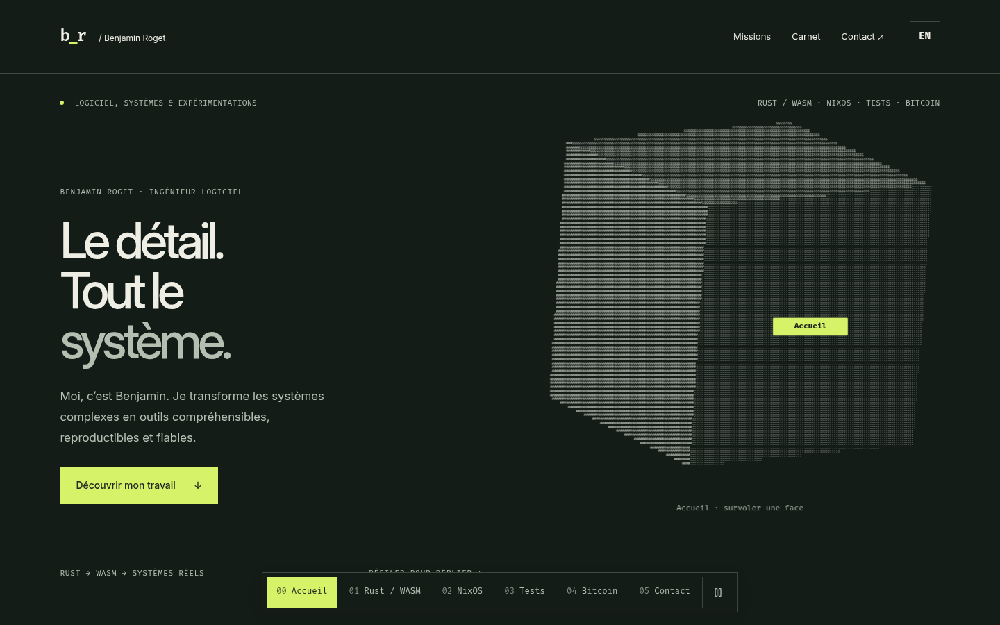
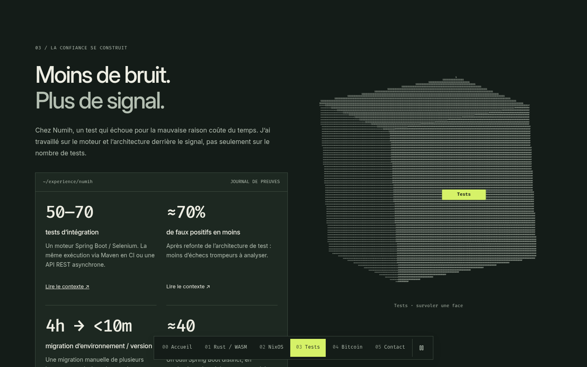
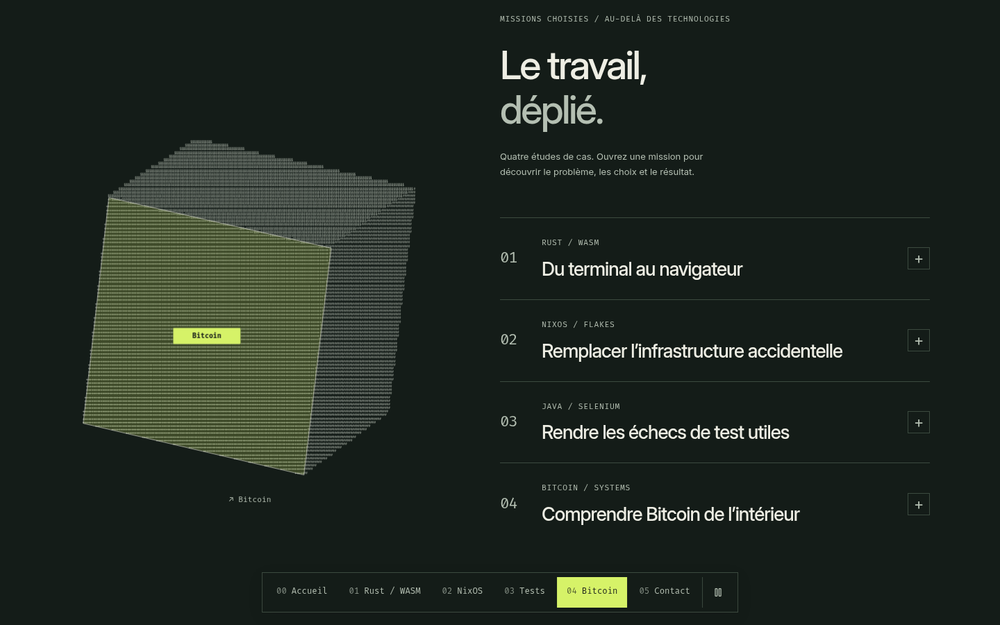
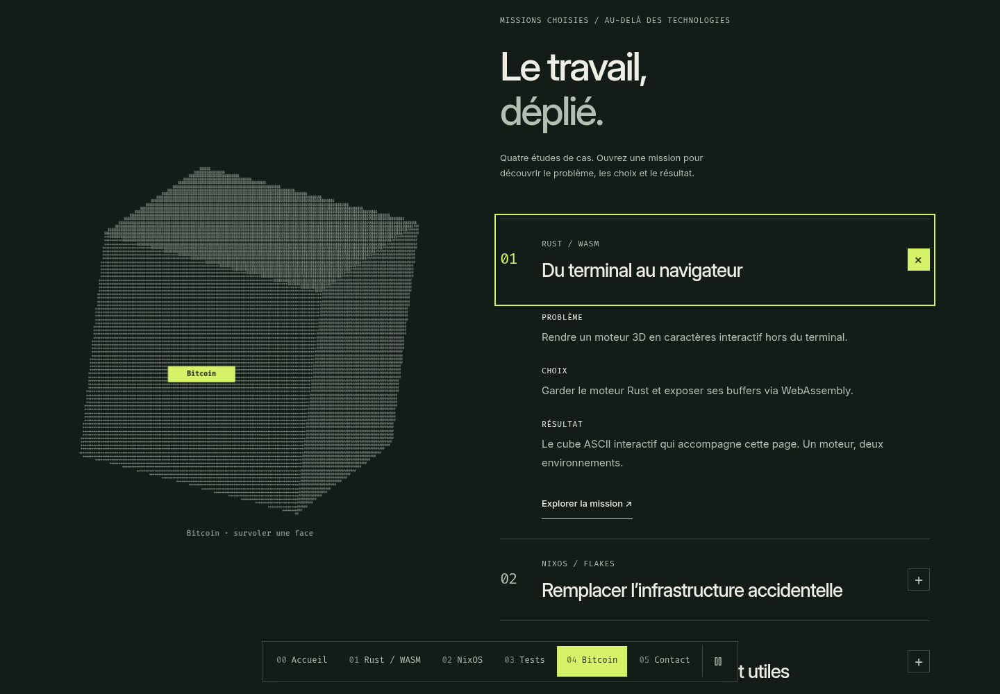
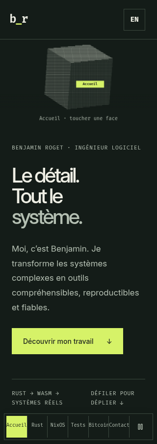
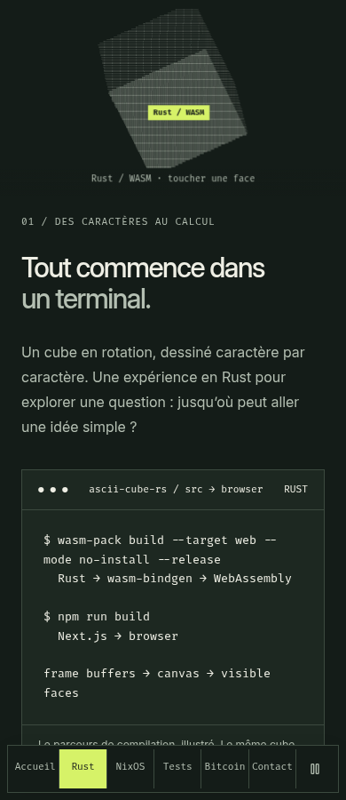
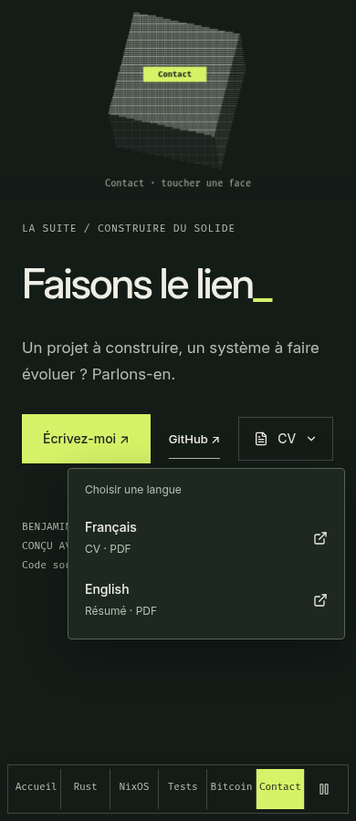

# Page principale — revue de design

Le [diagnostic et les décisions](../../homepage-design-review.md) décrivent
cette passe sur `feat/scroll-cube-scene`. Les images concernent le véritable
build standalone Node 22, pas une maquette. Le moteur Rust/WASM et ses données
restent ceux de la version précédente ; cette passe améliore la lecture et les
contrôles.

- Contrôle de design : FR/EN, 320/390/768/1024/1440/1920, typographie, métriques
  stables, débordements, navigation mobile, missions au clavier, menu CV et PDF,
  changement de langue et retour de focus. [Mesures](design-evidence.json).
- Suite de scène : 27 checkpoints, persistance du cube, scroll bidirectionnel,
  survol/clic des six faces, pause, reprise manuelle, mobile/paysage, réduction
  des animations et échec WASM simulé. [Mesures](scene-evidence.json).
- Molette native, absence de snap et d’inertie de position, encres du cube :
  [mesures de confort](comfort-evidence.json).
- États intermédiaires, tap tactile, interruption de navigation, erreurs console
  et WASM HTTP 200 / `application/wasm` :
  [mesures visuelles](visual-evidence.json).
- Build optimisé, TypeScript, lint ciblé, 180 orientations du raster historique,
  720 orientations du raster de scène et cinq régressions du CV HTML : PASS.

[Parcours enregistré](scroll-journey.webm) — 15fps, à 75% du viewport ; les PNG
ci-dessous gardent leur résolution native. Les intervalles rAF consignés sont
ceux de ce conteneur Chromium, pas une garantie de performances sur tout
appareil.

 

La CI construit désormais le paquet Nix indépendamment du serveur de production.
Le hash npm de la branche a été vérifié par `prefetch-npm-deps`. La construction
complète de Server peut échouer indépendamment sur le hash npm de son ancien
input de production ; aucun pin de production n’est changé ici.

Cette validation ne constitue pas une activation distante. Le preview conserve
son mTLS et son service `portfolio-test` séparé. Le lint global garde six
erreurs préexistantes dans des fichiers non modifiés. Les viewports mobiles sont
émulés avec Chromium, sans certification WCAG ni test physique Safari/iOS.
