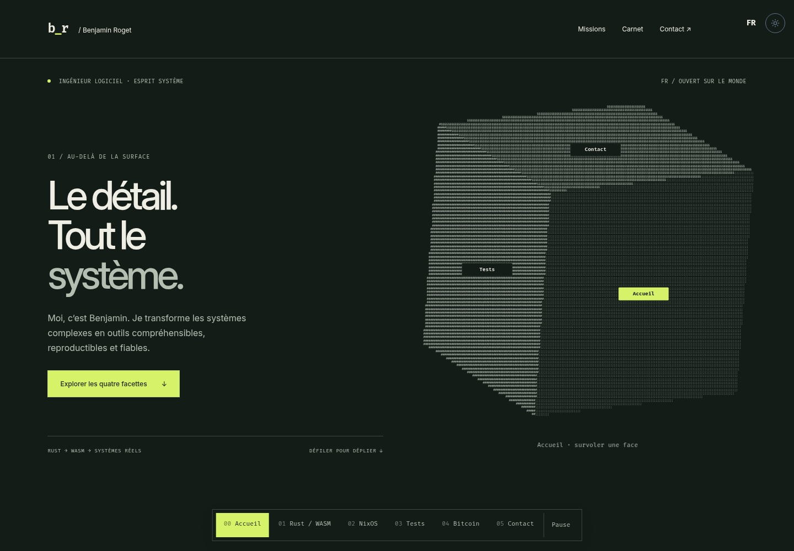
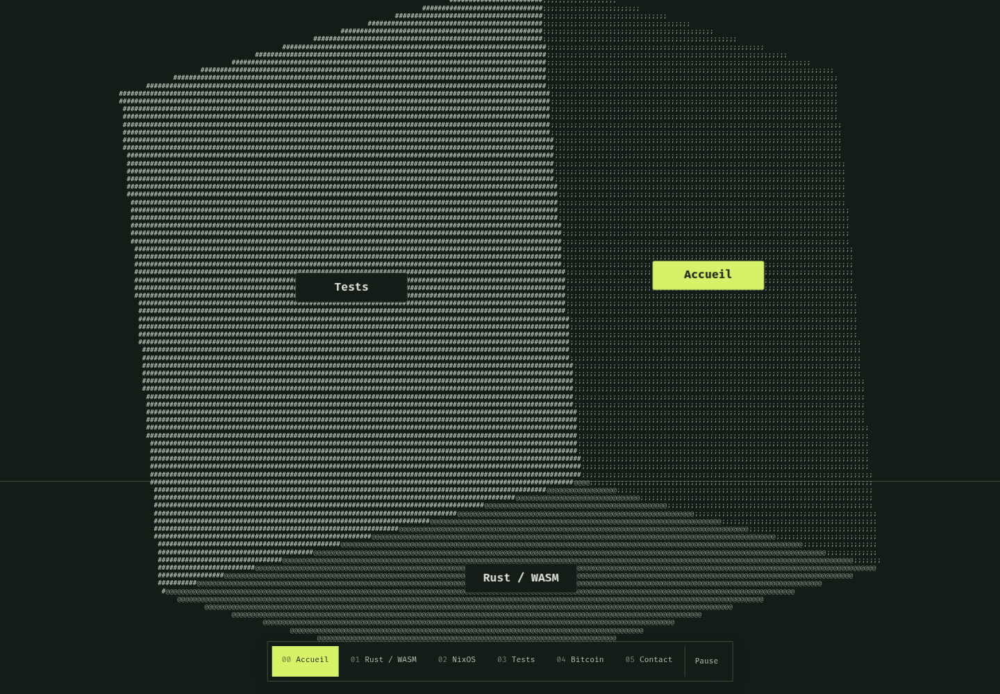
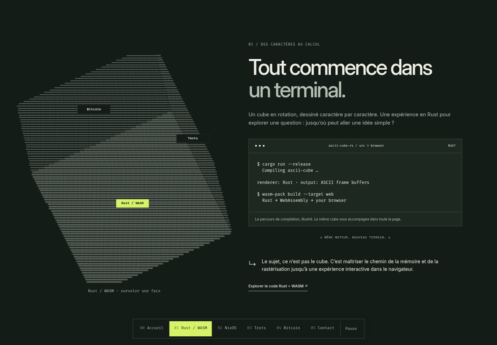
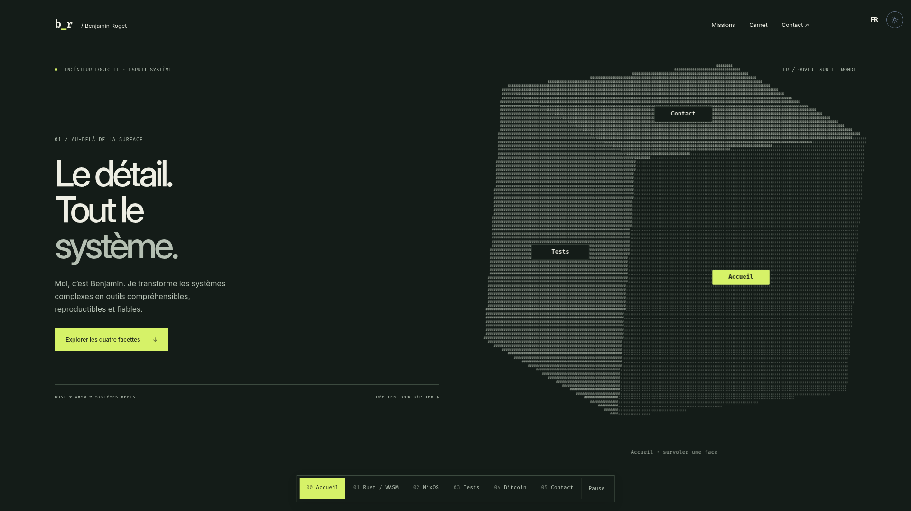
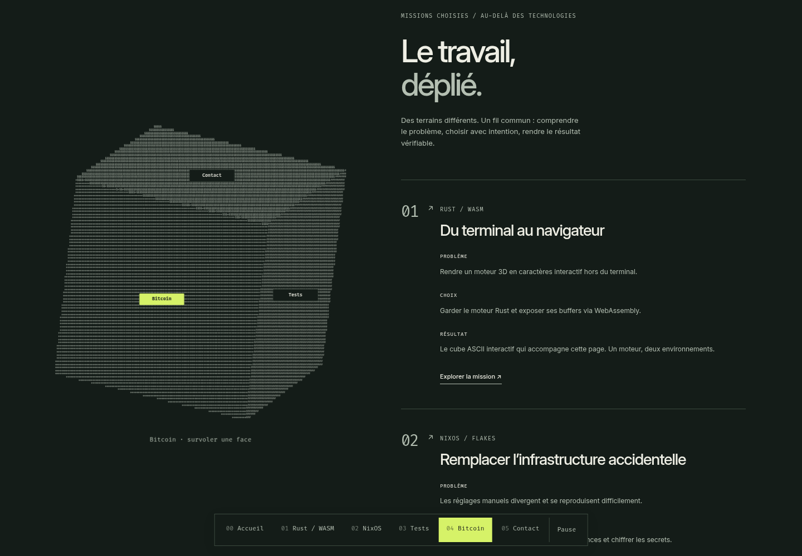
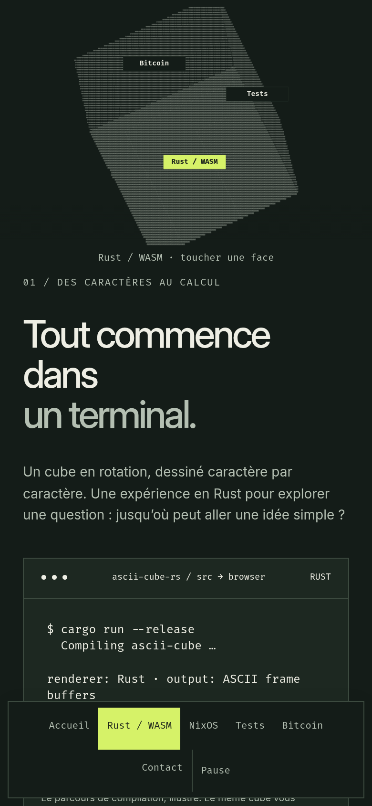

# Scroll scene review — 16 November 2026

Local optimized standalone server, Node 22.23.2 / Next.js 16.3.5, real Chromium
and the rebuilt Rust/WASM engine pinned by `flake.lock`. This report concerns
local application validation, **not** activation of the remote test service.

## Observed result

- One persistent cube; native scroll drives approach, central close-up, retreat
  and stable reading poses. The first intro fades before the close-up; Rust text
  appears after the cube retreats. Reverse traversal uses the same progression.
- Full-width charcoal surface, including 1920px. No blue outer margins. Regular
  measured monospace material, distinct face lighting, DPR-aware backing canvas.
- Nix and Testing share the right-side cube composition; Bitcoin, missions and
  contact share the left-side cube composition. Mission numbers no longer
  overlap their headings. Source content and attributed project/test results are
  retained.
- Actual face polygons, hover suspension, six face clicks, text and keyboard
  navigation, mobile face tap, resize, landscape, reduced motion and failed-WASM
  fallback were exercised. An ongoing smooth navigation is cancelled by manual
  wheel/touch/pointer/scroll-key intent without cancelling native wheel events.

## Checks

| Check                                                                 | Result                                                                     |
| --------------------------------------------------------------------- | -------------------------------------------------------------------------- |
| Node 22 optimized build; standalone server                            | PASS                                                                       |
| TypeScript; changed-file ESLint; diff whitespace                      | PASS                                                                       |
| Legacy raster / 100×100 texture contract, 180 orientations            | PASS, zero holes                                                           |
| Scene raster 200×100 / zoom 3300, 720 orientations; texture quadrants | PASS, zero holes                                                           |
| `test-scroll-scene.mjs`                                               | PASS, 27 checkpoints, no page errors                                       |
| `test-scroll-comfort.mjs`                                             | PASS, native 240px wheel, no snap or position inertia                      |
| `test-narrative-browser.mjs`                                          | PASS, EN/FR, 3 widths, retained controls/content                           |
| `capture-scroll-review.mjs`                                           | PASS, viewport sequence, manual interruption, mobile tap, console and WASM |
| Résumé HTML regressions                                               | PASS, 5 tests                                                              |
| Whole-repository ESLint                                               | Six pre-existing errors in unmodified files                                |

The [scene evidence](scene-evidence.json),
[comfort evidence](comfort-evidence.json) and
[visual/runtime evidence](visual-evidence.json) contain the actual observations.
The visual suite reports HTTP 200 / `application/wasm`, no console/page errors,
canvas backing sizes and local frame intervals. These measurements describe this
Chromium container, not a performance guarantee for every device.

## Viewport evidence

[Recorded traversal](scroll-journey.webm) — 15fps, 75% scale, including reverse
travel. This recording shows composition and rhythm; the PNGs retain full
viewport resolution for inspecting ASCII detail.

 

## Remaining boundaries

The real test route is `https://test-portfolio.qgroget.com/fr`, configured in
nixos-config with mTLS and rootless `portfolio-test.service` on port 3002. There
is no declared `test-portoflio` alias. Deployment PR #112 prepares its exact
pin; production's independent `portfolio` input stays unchanged.

No SSH credential or mTLS client certificate is available here. The remote
service has **not** been updated or verified during this review. The full Nix
package also remains unbuilt locally: restricted namespaces and then disk space
prevented completing Nix setup. Rust/WASM, npm and standalone fallback builds
were completed. CI publishes a runnable standalone test artifact for manual
review. Chromium mobile emulation is not physical iOS/Safari validation.

See [the reproducible setup and commands](../../local-development.md).
